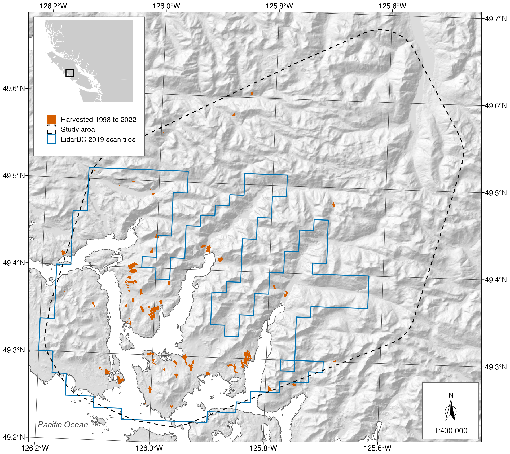
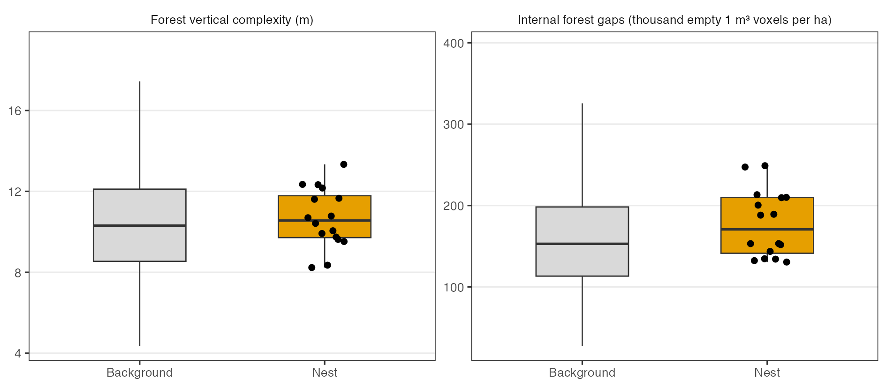

```{r}
#| label: setup
#| echo: !expr '!knitr::pandoc_to(c("docx", "latex"))'
#| output: false
# Rendering this document runs the whole analysis. Every table and figure is written
# by a chunk below into 03.outputs, and every number in the prose is read back from
# those files by inline R, so the text cannot drift from the results. The code is
# printed in the html render and left out of the Word render.
library(knitr)
knitr::opts_hooks$set(echo = \(options) { if (knitr::pandoc_to(c("docx", "latex"))) options$echo <- FALSE; options })
knitr::opts_chunk$set(echo = TRUE, warning = FALSE, message = FALSE)
# GitHub shows a flextable as a picture, so the markdown render prints each
# table's cells as a pipe table instead.
if (knitr::pandoc_to(c("gfm", "commonmark"))) {
  loadNamespace("flextable")
  registerS3method("knit_print", "flextable", \(x, ...) knitr::knit_print(knitr::kable(x$body$dataset, format = "pipe")), envir = asNamespace("knitr"))
}

repo <- normalizePath("..")
INP  <- file.path(repo, "02.inputs")
TBL  <- file.path(repo, "03.outputs", "tables")
FIG  <- file.path(repo, "03.outputs", "figures")
dir.create(TBL, recursive = TRUE, showWarnings = FALSE)
dir.create(FIG, recursive = TRUE, showWarnings = FALSE)

tbl <- function(f) read.csv(file.path(TBL, f))
fmt <- \(x, d = 2) formatC(x, format = "f", digits = d, big.mark = ",")
pv <- \(p) if (p < 0.001) "*P* < 0.001" else paste0("*P* = ", fmt(p))
ev <- \(what, col = "value", m = "local") { t <- tbl("T5_evaluation.csv"); t[[col]][t$model == m & t$metric == what] }
sep <- \(what, col) { t <- tbl("T4_separability.csv"); t[[col]][t$measure == what] }
smp <- \(what) { t <- tbl("T2_sample.csv"); t$n[t$step == what] }
nz <- \(what, col = "value", m = "outlier removal") { t <- tbl("T6_noise.csv"); t[[col]][t$model == m & t$metric == what] }
cs <- \(what, size, col = "value") { t <- tbl("T7_cell_size.csv"); t[[col]][t$metric == what & t$size_ha == size] }
rf <- \(what, a, col = "value") { t <- tbl("T8_refits.csv"); t[[col]][t$metric == what & t$analysis == a] }
acc <- \(cls) if (cls == "nest") 100 * ev("Nest cells above threshold") / ev("Nest cells") else 100 * (1 - ev("Background cells above threshold") / ev("Background cells"))

# Run `code` only when `path` is missing, so a render rebuilds an output that was
# deleted and leaves a finished one alone. Delete the file to force a rebuild.
build_once <- function(path, code) {
  if (!file.exists(path)) force(code)
  invisible(path)
}
```

# Abstract {.unnumbered}

A nesting-habitat model for the threatened Marbled Murrelet, built from airborne laser scans and nests in Desolation Sound, British Columbia, lost accuracy when transferred to Clayoquot Sound. Models fitted within one region had predicted nesting habitat better than pooled or transferred models, so a local model was expected to do better. This study rebuilt that model from 2019 scans and nests of birds radio-tracked from 2000 to 2002 (`r smp("nest cells in available forest")` nest and `r fmt(smp("background cells in available forest"), 0)` background cells in tall forest unharvested since 1998). Maximum entropy modeling of forest vertical complexity and internal forest gaps in 1 ha cells was scored by five-fold spatial cross-validation in 10 km blocks. Neither measure separated nest cells from background cells (forest vertical complexity, `r pv(sep("fvc", "p_value"))`; internal forest gaps, `r pv(sep("empty_gaps", "p_value"))`). Nest cells had more internal forest gaps than background cells, though not significantly. The model classed `r fmt(acc("nest"), 1)` percent of held-out nest cells and `r fmt(acc("background"), 1)` percent of background cells correctly, an average accuracy of `r fmt((acc("nest") + acc("background")) / 2, 1)` percent, which could not be distinguished from chance. The result held in 4 and 9 ha cells and across further checks. The local model's ranking of nest cells could not be shown to differ from that of the model transferred from Desolation Sound. With so few located nests, a local model gave no reason to replace the transferred model in mapping nesting habitat in Clayoquot Sound.

# Keywords {.unnumbered}

Airborne laser scanning; *Brachyramphus marmoratus*; habitat suitability; lidar; MaxEnt; model transferability; old-growth forest

# Introduction

The Marbled Murrelet, *Brachyramphus marmoratus* (Gmelin, 1789), was a seabird that nested inland in old-growth coniferous forest. It was listed as threatened in Canada and the United States, and loss of that forest was the primary reason given for its decline [@burger2001using]. In a review of science for federal forests in Washington, Oregon and northern California, Raphael et al. [-@raphael2018marbled, 333] wrote that the studies they summarized pointed "toward nesting habitat as the primary driver, but all these studies concede that relationships are correlational". The murrelet's nests were cryptic and difficult to locate [@burger2001using], so the nesting habitat retained for it in British Columbia was mapped from forest inventory, air photographs and aerial surveys [@mather2010marbled; @burger2018reliability]. Those maps were judged against the few nests found by radio telemetry [@burger2018reliability]. Burger et al. [-@burger2009new, 12] did "not anticipate having a much larger sample of actual nest sites to test, due to the high costs of telemetry studies needed to find large numbers of nests".

Nesting habitat was defined by nest platforms, the large limbs and thick epiphyte mats on which murrelets nested [@burger2010factors]. Ralph et al. [-@ralph1995ecology, 7] wrote that "it is the presence of adequate nesting platforms that defines suitable nesting habitat", and later work confirmed platforms as "the most important characteristic of murrelet nesting habitat" [@raphael2018marbled, 303]. Across six regions of British Columbia, tree diameter was the most important predictor of platforms [@burger2010factors]. Platforms began "to appear regularly in trees >30 m tall" and were "most abundant in the large emergent trees" [@burger2010factors, 736]. In Washington and Oregon, nests sat on platforms with more horizontal cover, a larger diameter and more moss than other platforms in the same stands [@hamer2021marbled]. Silvergieter and Lank [-@silvergieter2011patch, 15] noted that the number of platforms, a key term in their Clayoquot Sound models, "cannot be quantitatively measured by remote methods".

The provincial habitat model classed forest-cover polygons as suitable by stand age, height, elevation and distance to the sea [@mather2010marbled]. Its authors judged it "suited to broad-scale estimation of Marbled Murrelet nesting habitat area, but not its precise location" [@mather2010marbled, 98]. Against 171 radio-tracked nests, it placed 52.6 percent in suitable habitat, 69.4 percent in Clayoquot Sound and 52.1 percent in Desolation Sound [@burger2018reliability]. In Clayoquot Sound, the model applied a regional algorithm built from inventory maps drawn for that area [@bahn2002habitat; @mather2010marbled], and its better result there "might be attributed" to that algorithm [@burger2018reliability, 13].

Air photo interpretation and low-level aerial surveys ranked stands by canopy features seen from above [@waterhouse2008using; @burger2009new]. Fine-scale aerial surveys placed 85.2 percent of 135 nests in suitable habitat and were the only method that estimated nest platforms [@burger2018reliability]. Their ranks separated nests from random points in Desolation Sound and Toba Inlet but not in Clayoquot Sound [@waterhouse2009using]. Re-examining the first comparison of radio-tracked nests with random points in the two sounds, Burger and Page [-@burger2007need, 1276] contended that "coarse-scale satellite imagery and forest cover mapping lack the spatial resolution to adequately test effects of patch size and forest edges on marbled murrelets". They found "little or no support" for that study's main conclusions and named "tree size, moss development, canopy micro-structure, aspect, topographic complexity within stands" as likely to matter more [@burger2007need, 1279]. All of these methods inferred forest structure from maps or from observers' ranks rather than measuring it.

Airborne laser scanning measured canopy height and the vertical arrangement of vegetation directly, and it had been linked to the habitat of many forest animals. Across 173 studies, Acebes et al. [-@acebes2021disentangling, 7] found that "canopy vertical distribution traits were less important for birds than canopy height and cover". Across 50 bird studies, measures of canopy vertical variability showed a relationship in only 44 percent of their uses [@bakx2019categorization]. In the Sierra Nevada, cover in trees taller than 48 m was "the canopy structure most highly selected for" by California spotted owls [@north2017cover, 166]. Cover from 2 to 16 m was avoided. In that study, measures of gap area were "among the least distinct" [@north2017cover, 171]. Northern spotted owls in Oregon selected activity centers with more canopy cover and a more uneven canopy surface within 100 m [@sovern2019activity]. Sovern et al. [-@sovern2019activity, 722] linked weak selection for a contiguous canopy to maturing stands, where trees "senesce, break, and fall over creating small openings". In western Washington, conifer stands older than about 75 years showed a rougher canopy surface and a lower canopy density as they aged [@kane2010examining].

For the murrelet, Burger et al. [-@burger2009new, 12] wrote that laser scanning "might provide detailed three-dimensional measures of canopy structure that could be extremely valuable for large-scale assessments of Marbled Murrelet nesting habitats". In southwestern Oregon, a laser-scan model of stand occupancy scored 0.74 on the area under the receiver operating characteristic curve (AUC), against 0.64 for a model built from vegetation maps [@hagar2014modeling]. An AUC of 0.5 marked a model that ranked occupied stands no better than chance. On northern Vancouver Island, measures mostly from laser scans flown in 2012 predicted helicopter survey ranks with an overall accuracy of 71.05 percent, and elevation outranked every canopy measure [@clyde2017fine]. In northern California redwood timberland scanned in 2017 and 2018, measures of tall individual trees predicted habitat suitability, while area-based canopy and height-percentile measures "displayed little predictive value" beside them [@lamphear2025marbled, 12]. Lamphear et al. [-@lamphear2025marbled, 23] wrote that the tree measures were "more direct measures of small-scale marbled murrelet habitat requirements than indirect area-based point cloud metrics". All three models were fitted to survey records of occupancy or habitat rank rather than to nests [@hagar2014modeling; @clyde2017fine; @lamphear2025marbled]. Hagar et al. [-@hagar2014modeling] also compared 11 climbed nest trees with random points. Two measures related to tree height and cover were larger at the nests, with an average AUC of 0.91.

In Desolation Sound, Cosgrove et al. [-@cosgrove2024modeling] trained a laser-scan model on 58 radio-tracked nests, using maximum entropy modeling (MaxEnt) in 1 ha cells. Predicted suitability rose with forest vertical complexity, the spread of point heights, and fell with internal forest gaps, the empty space below the top of the canopy. The fall with gaps reversed the authors' expectation that gaps would favor nesting by "providing canopy openings for nest access and flight maneuvers" [@cosgrove2024modeling, 4]. Burger et al. [-@burger2009new, 5] reported that "small gaps in the canopy are typically found next to nest trees". On Haida Gwaii, small gaps were prevalent on air photos at all 7 nest patches found in 2000 [@waterhouse2007assessing]. On the south coast, a model was fitted to 118 nests tracked from 1998 to 2002 in three areas [@waterhouse2008using]. Judged "most applicable to Desolation Sound", it predicted nests where "small gaps are sporadic but where large gaps do occur" [@waterhouse2008using, 27].

The effect of edges and openings also changed with their kind and their scale. In four regions of southwestern British Columbia, disturbance of simulated nests was 2.5 times higher at hard edges, beside clearcuts 5 to 11 years old, than in forest interiors [@malt2009marbled]. Malt and Lank [-@malt2009marbled, 1274] found "no edge effect at natural edges", which lay beside large rivers or avalanche chutes. Natural-edged patches also held "the greatest levels of epiphyte cover and platform tree density" [@vanrooyen2011relating, 549]. Across Washington, Oregon and northern California, occupancy fell with edge within 2 km of survey stations and rose with edge within 100 m [@valente2023fragmentation]. Those authors "did not distinguish natural and anthropogenic canopy gaps" [@valente2023fragmentation, 8]. In western Washington and southwest Vancouver Island, 18 radio-tracked nest sites had less canopy cover of dominant conifers than nearby control plots, 39.3 against 48.6 percent [@wilk2016nesting]. Wilk et al. [-@wilk2016nesting, 170] read this as "a more open structure around nest sites than in other areas of the forest".

For vertical complexity, Silvergieter and Lank [-@silvergieter2011marbled, 10] wrote that "preference for heterogeneous forest patches with increased vertical canopy complexity has been well established by other studies". On southwest Vancouver Island from 1991 to 1999, the spread of tree heights in ground plots at 27 survey stations correlated with occupied murrelet activity [Spearman *r*~s~ = 0.495, *P* < 0.01] [@burger2004inland]. In Washington and Oregon from 1995 to 1999, however, climbers searching random plots found the effect of "tree diameter standard deviation (a measure of canopy complexity)" on nesting unclear [@hamer2021marbled, 8]. In Clayoquot Sound, ground plots at 27 nests found from 2000 to 2002 showed canopy shorter and less varied in height than at random sites [@silvergieter2011patch]. Mean canopy height was 33.4 against 37.6 m and its standard deviation 4.9 against 6.0 m, whereas at 37 Desolation Sound nests both ran the other way [@silvergieter2011patch]. From laser scans at 1 ha, by contrast, nests in both sounds lay in taller and more vertically complex forest than random cells [@cosgrove2024modeling]. Waterhouse et al. [-@waterhouse2009using, 91] found "only weak evidence" that vertical complexity rated from a helicopter helped to predict nests in Desolation Sound, Toba Inlet and Clayoquot Sound.

Models had been moved from Desolation Sound to Clayoquot Sound before laser scans were used. Zharikov et al. [-@zharikov2007influence] fitted landscape models from forest inventory maps to 90 Desolation Sound nests and tested them on 36 Clayoquot Sound nests. There, the models scored AUCs of 0.558 to 0.663 [@zharikov2007influence]. The authors traced the weak transfer to old growth, which covered 18 percent of the training extent against 55 percent of the test extent [@zharikov2007influence]. Transferred to Clayoquot Sound, the Desolation Sound laser-scan model scored an AUC of 0.63, against 0.77 where it was trained [@cosgrove2024modeling]. Its Boyce index, a measure of how closely predicted suitability tracked nest frequency, fell from 0.99 to 0.67 [@cosgrove2024modeling]. The AUC fell below the 0.7 those authors set for a good model, yet they judged that the transferred model "maintained reasonable accuracy" [@cosgrove2024modeling, 9]. In Oregon, a laser-scan occupancy model transferred from the Coos Bay District to the Siuslaw National Forest scored an AUC of 0.73, against 0.78 for a locally selected model [@hagar2018modeling]. Hagar et al. [-@hagar2018modeling, 1] found that "neither of these transferred models were considered competitive with a model trained on local data". Ground-plot models fitted to each sound placed 59 percent of Clayoquot Sound nests above a score of 0.7, against 15 percent for a pooled model without regional terms [@silvergieter2011patch]. Silvergieter and Lank [-@silvergieter2011patch, 13] concluded that one resource selection function "does not describe habitat selection nearly as well as region-specific models". They judged that "the limited size of our dataset and strong regional interactions precluded" testing Desolation Sound models against Clayoquot Sound nests [@silvergieter2011patch, 11]. Of the provincial habitat classifications, Burger et al. [-@burger2018reliability, 15] wrote that "the regional differences that have been found suggest caution in applying results from one region to another".

Desolation Sound had lost about 80 percent of its original nesting habitat to logging [@burger2018reliability]. Burger et al. [-@burger2018reliability, 11] wrote that the distribution of nests in what remained "might not be typical for the species in less disturbed landscapes, such as Clayoquot Sound". Burger and Page [-@burger2007need, 1278] had asked whether the results from Clayoquot Sound, "with relatively little forest loss", might "represent a truer reflection on the habitat preferences of nesting murrelets". Air photo interpretation detected the fewest signs of nest-site selection in Clayoquot Sound, in part because "random sites would more often fall in poorer habitats on the Sunshine Coast compared to Clayoquot Sound with its extensive areas of available habitat" [@waterhouse2008using, 31].

The way nests were compared with other forest also limited what these studies could detect. Murrelet use of random sites was unknown, so Waterhouse et al. [-@waterhouse2008using, 21] compared nests with available sites "rather than the more powerful contrast of used versus unused sites". In Clayoquot Sound, the nesting dates of radio-tracked birds "were substantially biased towards later nests" [@mcfarlanetranquilla2005breeding, 357]. In Oregon, Valente et al. [-@valente2024presence, 10] were "only able to find 17 active nests despite radiotagging 239 individuals" over four breeding seasons. Raphael et al. [-@raphael2018marbled, 333] proposed to "build models exclusively from training sites that represent actual murrelet nests".

The Clayoquot Sound nests had served to test models transferred from Desolation Sound, built from forest inventory [@zharikov2007influence] and from laser scans [@cosgrove2024modeling]. The provincial scans flown there in 2019 and the public release of the nest locations [@cooke2022marbled] made a local model possible. The first objective was to rebuild the two-measure model of Cosgrove et al. [-@cosgrove2024modeling] from local nests and laser scans and to score it on spatially separate groups of nests. The second was to compare that score with that of the Desolation Sound model transferred to Clayoquot Sound. Forest vertical complexity was expected to be higher at nest cells of 1 ha than in other available forest, as in Desolation Sound [@cosgrove2024modeling] and earlier ground studies [@burger2004inland; @silvergieter2011marbled]. Ground plots at Clayoquot Sound nests had shown the reverse [@silvergieter2011patch], so this direction was contested there. Internal forest gaps were expected to be fewer at nest cells, as in Desolation Sound [@cosgrove2024modeling]. Small gaps had nonetheless been reported at nest sites [@burger2009new; @waterhouse2007assessing], and nest sites had been more open than nearby forest [@wilk2016nesting]. Models fitted within one region had described nest sites or occupied stands there better than pooled or transferred models [@silvergieter2011patch; @hagar2018modeling]. The local model was therefore expected to score an AUC above the 0.63 of the transferred model. The expected direction of each measure and its source were listed in @tbl-attributes.

```{r}
#| label: tbl-attributes
#| tbl-cap: "Laser-scan measures entered in the model, with the direction of their relation to nest sites expected from prior work."
readr::read_csv("../02.inputs/derived/review-attributes-20261122.csv", show_col_types = FALSE) |>
  dplyr::transmute(Measure = measure, `Expected direction` = expected_direction, Reasoning = reasoning, Source = paste0("[", gsub("; ", "; @", paste0("@", citation)), "]")) |>
  knitr::kable(format = "pipe")
```

# Methods

## Study area

Clayoquot Sound lay on the west coast of Vancouver Island, British Columbia, at 49°12′ N, 126°06′ W (@fig-study-area). Its terrain was mountainous, with steep cliffs, glacial valleys, avalanche chutes and streams that broke the forest naturally, and it rose from sea level to 2,200 m [@zharikov2006habitat]. From April to August, mean temperature was 11.9 °C and rainfall 720 mm, cooler and wetter than the 13.4 °C and 300 mm of Desolation Sound [@zharikov2006habitat]. Old growth on the lower slopes was of western redcedar (*Thuja plicata* Donn ex D. Don) and western hemlock (*Tsuga heterophylla* (Raf.) Sarg.) [@zharikov2006habitat]. It also held Douglas-fir (*Pseudotsuga menziesii* (Mirb.) Franco) and Sitka spruce (*Picea sitchensis* (Bong.) Carrière) [@zharikov2006habitat]. Commercial logging there began after 1954 [@zharikov2006habitat]. The sound supported one of the highest concentrations of breeding Marbled Murrelets south of Alaska, including more than 10 percent of the estimated provincial population [@burger2001using]. The study area was the smallest convex polygon around the nests, widened by 5 km.

## Data and processing

From 2000 to 2002, Marbled Murrelets were captured at sea by spotlighting from late April to early June, fitted with radio transmitters and followed by helicopter to their nests [@zharikov2006habitat]. Each nest was photographed from the air and recorded by GPS, and it was confirmed by tree climbing where it could be reached from the ground [@zharikov2006habitat]. The published data set listed `r smp("nests in file")` nests, `r smp("nests found in 2000")` in 2000, `r smp("nests found in 2001")` in 2001 and `r smp("nests found in 2002")` in 2002, with a positional error of about 50 m [@cooke2022marbled]. Zharikov et al. [-@zharikov2007influence, 751] reported that 8 of the 36 nests located in Clayoquot Sound "could not be accessed from the ground".

```{r}
#| label: nests
# Marbled Murrelets at Clayoquot Sound, British Columbia, Canada (2000-2002), CS_nests.csv
# https://doi.org/10.5441/001/1.kg210889
build_once("../02.inputs/movebank/CS_nests.csv", curl::curl_download(
  "https://datarepository.movebank.org/server/api/core/bitstreams/1504af80-ae53-4e69-a6f6-3b2ce5d53958/content",
  "../02.inputs/movebank/CS_nests.csv"))
nests <- readr::read_csv("../02.inputs/movebank/CS_nests.csv", show_col_types = FALSE) |>
  sf::st_as_sf(coords = c("Long", "Lat"), crs = 4326) |>
  sf::st_transform(3157)
```

```{r}
#| label: tiles
# LidarBC Open LiDAR Data Index, point cloud layer
# https://services6.arcgis.com/ubm4tcTYICKBpist/arcgis/rest/services/LiDAR_BC_S3_Public/FeatureServer/4
build_once("../02.inputs/lidarbc/tiles.gpkg", {
  area <- nests |> sf::st_union() |> sf::st_convex_hull() |> sf::st_buffer(5000)
  query <- paste0(
    "https://services6.arcgis.com/ubm4tcTYICKBpist/arcgis/rest/services/LiDAR_BC_S3_Public/",
    "FeatureServer/4/query?where=year%3D2019&geometryType=esriGeometryEnvelope&inSR=4326",
    "&outFields=filename,s3Url&f=geojson&geometry=",
    area |> sf::st_transform(4326) |> sf::st_bbox() |> paste(collapse = ","))
  set.seed(2019)
  purrr::map(0:5, \(i) sf::read_sf(paste0(query, "&resultOffset=", i * 1000))) |>
    dplyr::bind_rows() |>
    sf::st_transform(3157) |>
    dplyr::filter(lengths(sf::st_intersects(sf::st_centroid(geometry), area)) > 0) |>
    dplyr::mutate(
      nest = lengths(sf::st_intersects(geometry, sf::st_buffer(nests, 150))) > 0,
      background = dplyr::row_number() %in% sample(which(!nest), 40)) |>
    sf::write_sf("../02.inputs/lidarbc/tiles.gpkg")
})
tiles <- sf::read_sf("../02.inputs/lidarbc/tiles.gpkg")
```

```{r}
#| label: laz
# LidarBC 2019 point clouds, https://lidar.gov.bc.ca/
dir.create("../02.inputs/lidarbc/laz", showWarnings = FALSE)
tiles |>
  sf::st_drop_geometry() |>
  dplyr::filter(nest | background) |>
  purrr::pwalk(\(filename, s3Url, ...) {
    laz <- file.path("../02.inputs/lidarbc/laz", filename)
    build_once(laz, curl::curl_download(s3Url, laz))
  })
```

```{r}
#| label: thin
dir.create("../02.inputs/derived/thin", recursive = TRUE, showWarnings = FALSE)
list.files("../02.inputs/lidarbc/laz", "laz$") |>
  purrr::walk(\(f) build_once(file.path("../02.inputs/derived/thin", f), {
    h <- lidR::readLASheader(file.path("../02.inputs/lidarbc/laz", f))
    keep <- min(1, 15 * (h$`Max X` - h$`Min X`) * (h$`Max Y` - h$`Min Y`) /
      h$`Number of point records`)
    las <- lidR::readLAS(file.path("../02.inputs/lidarbc/laz", f), select = "xyzc",
        filter = paste("-drop_class 7 -drop_withheld -keep_random_fraction", keep)) |>
      lidR::decimate_points(lidR::homogenize(12, 10))
    if (!lidR::is.empty(las)) {
      lidR::writeLAS(las, file.path("../02.inputs/derived/thin", f))
      rlas::writelax(file.path("../02.inputs/derived/thin", f))
    }
  }))
```

Point clouds came from LidarBC, the open lidar program of the Province of British Columbia, and only nests inside its 2019 Vancouver Island acquisition were used. The acquisition used a Riegl VQ-1560i sensor flown 1,500 m above the ground, with 30 percent swath overlap and a target of 8 pulses per square meter [@geobc2023lidar]. Its vertical accuracy on open ground was 0.067 m at the 95 percent level, from 203 check points [@geobc2023lidar]. The point clouds were downloaded as compressed LAS files, with ground and noise classes inherited from the contractor. Of the `r nrow(tiles)` tiles centered in the study area, the `r sum(tiles$nest)` within 150 m of a nest were used as nest tiles. A further `r sum(tiles$background)`, drawn at random from the rest, were used as background tiles. Points classed as noise, and points the contractor had flagged as withheld from processing, were dropped. Each tile was thinned at random to at most 12 points per square meter within 10 m squares, so that density did not differ between nest and background tiles.

Forest harvested from 1998 to 2022 was screened out with the Canada Forest Harvest 1985–2022 product of the National Terrestrial Ecosystem Monitoring System [@hermosilla2016mass]. The product recorded the year of stand-replacing harvest on a 30 m grid.

```{r}
#| label: ntems
# Canada Forest Harvest 1985-2022, National Terrestrial Ecosystem Monitoring System
# https://opendata.nfis.org/downloads/forest_change/CA_Forest_Harvest_1985-2022.zip
build_once("../02.inputs/ntems/harvest_cs.tif", {
  curl::curl_download(
    "https://opendata.nfis.org/downloads/forest_change/CA_Forest_Harvest_1985-2022.zip",
    "../02.inputs/ntems/CA_Forest_Harvest_1985-2022.zip")
  unzip("../02.inputs/ntems/CA_Forest_Harvest_1985-2022.zip", exdir = "../02.inputs/ntems")
  harvest <- list.files("../02.inputs/ntems", "\\.tif$", recursive = TRUE, full.names = TRUE)[1] |>
    terra::rast()
  terra::crop(harvest, tiles |> sf::st_transform(terra::crs(harvest)) |> terra::vect(),
    filename = "../02.inputs/ntems/harvest_cs.tif")
})
```

```{r}
#| label: dem
# Medium Resolution Digital Elevation Model (MRDEM), 30 m, Natural Resources Canada
# https://canelevation-dem.s3.ca-central-1.amazonaws.com/mrdem-30/mrdem-30-dtm.tif
dir.create("../02.inputs/mrdem", showWarnings = FALSE)
build_once("../02.inputs/mrdem/dtm_cs.tif", {
  # The map frame with 4 km to spare, so the relief has no edge effects
  window <- sf::st_as_sfc(sf::st_bbox(c(xmin = 262000, ymin = 5450000, xmax = 328000, ymax = 5513000), crs = 3157))
  dtm <- terra::rast("/vsicurl/https://canelevation-dem.s3.ca-central-1.amazonaws.com/mrdem-30/mrdem-30-dtm.tif")
  terra::crop(dtm, terra::ext(sf::st_bbox(sf::st_transform(window, terra::crs(dtm))))) |>
    terra::project("EPSG:3157", res = 30, method = "bilinear") |>
    terra::crop(terra::vect(window), filename = "../02.inputs/mrdem/dtm_cs.tif", gdal = "COMPRESS=DEFLATE")
})
```

```{r}
#| label: fig-study-area
#| fig-cap: !expr paste0("Clayoquot Sound on the west coast of Vancouver Island, British Columbia. The dashed line bounded the study area, drawn 5 km around the radio-tracked nests. The blue line bounded the ", nrow(tiles), " LidarBC scan tiles flown in 2019, each about ", round(mean(as.numeric(sf::st_area(tiles))) / 1e6, 1), " km², and orange marked forest harvested from 1998 to 2022. Shading showed relief from the 30 m Medium Resolution Digital Elevation Model of Natural Resources Canada. Nest locations were not shown. The inset placed the study area on Vancouver Island. The main map was drawn at a scale of 1:400,000. Map lines delineate study areas and do not necessarily depict accepted national boundaries.")
# Freshwater Atlas Coastlines, Province of British Columbia
# https://catalogue.data.gov.bc.ca/dataset/freshwater-atlas-coastlines
dir.create("../02.inputs/fwa", showWarnings = FALSE)
build_once("../02.inputs/fwa/coastline.gpkg", sf::read_sf("https://openmaps.gov.bc.ca/geo/pub/wfs?service=WFS&version=2.0.0&request=GetFeature&typeNames=pub:WHSE_BASEMAPPING.FWA_COASTLINES_SP&outputFormat=application/json&srsName=EPSG:3157&bbox=980000,460000,1045000,525000,urn:ogc:def:crs:EPSG::3005") |> sf::write_sf("../02.inputs/fwa/coastline.gpkg"))
build_once("../03.outputs/figures/F1_study_area.png", {
  frame <- sf::st_bbox(c(xmin = 266000, ymin = 5454000, xmax = 324000, ymax = 5509000), crs = 3157)
  coast <- sf::read_sf("../02.inputs/fwa/coastline.gpkg")
  # Natural Earth 1:10 million admin 0 countries, read through the rnaturalearthhires package
  # https://www.naturalearthdata.com/downloads/10m-cultural-vectors/10m-admin-0-countries/
  land <- rnaturalearth::ne_countries(scale = 10, country = c("Canada", "United States of America"), returnclass = "sf") |> sf::st_transform(3157)
  harvest <- terra::rast("../02.inputs/ntems/harvest_cs.tif") |> terra::project("EPSG:3157", method = "near", res = 30) |> terra::aggregate(3, fun = "max") |> (\(r) r >= 1998)() |> terra::as.data.frame(xy = TRUE) |> dplyr::filter(dplyr::if_any(3))
  area <- nests |> sf::st_union() |> sf::st_convex_hull() |> sf::st_buffer(5000)
  # Shaded relief lit from the northwest at 40 degrees, drawn as a grey image under every layer
  dtm <- terra::rast("../02.inputs/mrdem/dtm_cs.tif")
  relief <- terra::shade(terra::terrain(dtm, "slope", unit = "radians"), terra::terrain(dtm, "aspect", unit = "radians"), angle = 40, direction = 315)
  relief <- terra::ifel(dtm > 1, relief, NA)
  shade <- terra::as.matrix(relief, wide = TRUE)
  tone <- 0.62 + 0.38 * pmax(0, pmin(1, shade))
  shade <- matrix(ifelse(is.na(tone), "#FFFFFF00", grDevices::grey(ifelse(is.na(tone), 1, tone))), nrow(shade))
  grat <- sf::st_graticule(sf::st_as_sfc(frame), crs = sf::st_crs(3157), datum = sf::st_crs(4326), lon = seq(-126.4, -125.2, 0.2), lat = seq(49.1, 49.8, 0.1))
  main <- ggplot2::ggplot() +
    ggplot2::annotation_raster(grDevices::as.raster(shade), xmin = terra::xmin(relief), xmax = terra::xmax(relief), ymin = terra::ymin(relief), ymax = terra::ymax(relief)) +
    ggplot2::geom_sf(data = grat, colour = "grey25", linewidth = 0.15) +
    ggplot2::geom_tile(data = harvest, ggplot2::aes(x, y, fill = "Harvested 1998 to 2022"), width = 90, height = 90) +
    ggplot2::geom_sf(data = coast, colour = "grey35", linewidth = 0.2) +
    ggplot2::geom_sf(data = sf::st_union(tiles), ggplot2::aes(colour = "LidarBC 2019 scan tiles"), fill = NA, linewidth = 0.4) +
    ggplot2::geom_sf(data = area, ggplot2::aes(linetype = "Study area"), fill = NA, colour = "black", linewidth = 0.4) +
    ggplot2::scale_fill_manual(NULL, values = "#D55E00") + ggplot2::scale_colour_manual(NULL, values = "#0072B2") + ggplot2::scale_linetype_manual(NULL, values = "dashed") +
    ggplot2::annotate("text", x = 267200, y = 5456300, label = "Pacific Ocean", hjust = 0, fontface = "italic", size = 2.6, colour = "grey30") +
    ggplot2::annotate("rect", xmin = 316400, xmax = 323600, ymin = 5454400, ymax = 5461600, fill = "white", colour = "grey40", linewidth = 0.3) +
    ggplot2::annotate("text", x = 320000, y = 5455500, label = "1:400,000", size = 2.4) +
    ggspatial::annotation_north_arrow(location = "br", which_north = "true", height = grid::unit(0.95, "cm"), width = grid::unit(0.6, "cm"),
      pad_x = grid::unit(0.7, "cm"), pad_y = grid::unit(0.6, "cm"), style = ggspatial::north_arrow_fancy_orienteering(text_size = 6, line_width = 0.5)) +
    ggplot2::scale_x_continuous(breaks = seq(-126.4, -125.2, 0.2)) + ggplot2::scale_y_continuous(breaks = seq(49.1, 49.8, 0.1)) +
    ggplot2::coord_sf(crs = 3157, datum = 4326, xlim = frame[c(1, 3)], ylim = frame[c(2, 4)], expand = FALSE, label_axes = "ENEN") +
    ggplot2::theme_void(base_size = 8) +
    ggplot2::theme(panel.border = ggplot2::element_rect(fill = NA, colour = "black", linewidth = 0.5), panel.background = ggplot2::element_rect(fill = "white", colour = NA),
      axis.text = ggplot2::element_text(size = 6.5, colour = "black"), axis.ticks = ggplot2::element_line(colour = "black", linewidth = 0.3), axis.ticks.length = grid::unit(2, "pt"),
      legend.position = "none", plot.margin = ggplot2::margin(2, 2, 2, 2))
  key <- cowplot::get_plot_component(main + ggplot2::theme(legend.position = "right", legend.spacing.y = grid::unit(0, "pt"), legend.margin = ggplot2::margin(0, 0, 0, 0), legend.key.size = grid::unit(9, "pt")), "guide-box-right")
  locator <- ggplot2::ggplot() +
    ggplot2::geom_sf(data = land, fill = "grey80", colour = NA) +
    ggplot2::geom_sf(data = sf::st_as_sfc(frame), fill = NA, colour = "black", linewidth = 0.4) +
    ggplot2::coord_sf(crs = 3157, xlim = c(100000, 800000), ylim = c(5250000, 5900000), expand = FALSE, datum = NA) +
    ggplot2::theme_void() + ggplot2::theme(panel.background = ggplot2::element_rect(fill = "white", colour = NA))
  pw <- 58000 / 4e3; ph <- 55000 / 4e3
  g <- ggplot2::ggplotGrob(main)
  panel <- g$layout[g$layout$name == "panel", ]
  g$widths[panel$l] <- grid::unit(pw, "cm"); g$heights[panel$t] <- grid::unit(ph, "cm")
  grDevices::pdf(NULL)
  cm <- \(u) grid::convertUnit(u, "cm", valueOnly = TRUE)
  fw <- sum(cm(g$widths)); fh <- sum(cm(g$heights))
  left <- sum(cm(g$widths[seq_len(panel$l - 1)])); bottom <- sum(cm(g$heights[-seq_len(panel$b)]))
  grDevices::dev.off()
  at <- \(x, y) c((left + x * pw) / fw, (bottom + y * ph) / fh)
  fig <- cowplot::ggdraw(g) +
    cowplot::draw_grob(grid::rectGrob(gp = grid::gpar(fill = "white", col = "grey40", lwd = 0.8)), x = at(0.012, 0)[1], y = at(0, 0.665)[2], width = 0.245 * pw / fw, height = 0.323 * ph / fh) +
    cowplot::draw_plot(locator, x = at(0.022, 0)[1], y = at(0, 0.79)[2], width = 0.225 * pw / fw, height = 0.19 * ph / fh) +
    cowplot::draw_grob(key, x = at(0.022, 0)[1], y = at(0, 0.672)[2], width = 0.225 * pw / fw, height = 0.11 * ph / fh, hjust = 0, vjust = 0) +
    ggplot2::theme(plot.background = ggplot2::element_rect(fill = "white", colour = NA))
  ggplot2::ggsave("../03.outputs/figures/F1_study_area.png", fig, width = fw, height = fh, units = "cm", dpi = 300)
})

```

Heights were normalized to the ground by a triangulated surface on the thinned ground points, and points below 0 m or at or above 100 m were discarded. Following the grid and definitions of Cosgrove et al. [-@cosgrove2024modeling], forest height, forest vertical complexity and internal forest gaps were computed in 1 ha cells with lidR [@roussel2020lidr]. Forest height was the 95th percentile of all point heights, ground points included, and forest vertical complexity was their standard deviation. Internal forest gaps were the number of empty 1 m cubes, or voxels, below the highest filled voxel of each 1 m column, summed over the cell. An empty voxel could be open space or space that no laser pulse reached, and the two could not be told apart. Internal forest gaps depended on point density, so they were not comparable with those of Cosgrove et al. [-@cosgrove2024modeling, 3], whose Clayoquot Sound scans averaged 29.9 points per square meter. Two scan checks, the share of 1 m columns with returns and the point density, were used only to screen cells.

```{r}
#| label: metrics
structure_metrics <- function(X, Y, Z) {
  voxels <- unique(data.table::data.table(x = floor(X), y = floor(Y), z = floor(Z)))
  columns <- voxels[, list(n = .N, top = max(z)), by = c("x", "y")]
  list(
    fh = quantile(Z, 0.95),
    fvc = sd(Z),
    empty_gaps = sum(columns$top + 1 - columns$n),
    cover = nrow(columns) / 1e4,
    density = length(Z) / 1e4)
}
build_once("../02.inputs/derived/metrics.tif", {
  ctg <- lidR::readLAScatalog("../02.inputs/derived/thin")
  lidR::opt_chunk_size(ctg) <- 1000
  lidR::opt_chunk_buffer(ctg) <- 20
  lidR::opt_chunk_alignment(ctg) <- c(0, 0)
  lidR::opt_stop_early(ctg) <- FALSE
  lidR::opt_progress(ctg) <- FALSE
  lidR::catalog_map(ctg, \(las) las |>
      lidR::normalize_height(lidR::tin()) |>
      lidR::filter_poi(Z >= 0, Z < 100) |>
      lidR::pixel_metrics(~structure_metrics(X, Y, Z), res = 100, start = c(0, 0))) |>
    terra::writeRaster("../02.inputs/derived/metrics.tif")
})
```

Available forest was unharvested since 1998 and at least 20 m tall, as in Cosgrove et al. [-@cosgrove2024modeling], though here the 20 m applied to each cell's forest height. A cell counted as harvested when any 30 m pixel in it had been harvested from 1998 to 2022. The screen ran to the product's last year, so cells cut after the scans were also left out. The product recorded only stand-replacing harvest, so partial cutting and natural disturbance were not screened out. A cell cut before 1998 could still count as available forest if its forest height reached 20 m by 2019. The 20 m minimum was lower than the height at which nest platforms began to appear regularly, in trees over 30 m tall [@burger2010factors]. Cells where returns reached fewer than 90 percent of 1 m columns, or fewer than 10 points per square meter after thinning, were also left out. Neighboring tiles were processed together, so cells lost columns only at the outer edge of the downloaded tiles. These cells were incompletely scanned, so their structure was not comparable with that of other cells. Internal forest gaps were summed only over columns with returns, so missing columns lowered a cell's count, while sparse points raised it. Nest cells were available-forest cells with a nest, and background cells were all available-forest cells in the background tiles (@tbl-sample). The nest sample was small, and the nests were found 17 to 19 years before the scans were flown. Each step from the nest file and scans to the modeled sample was listed with its data, dates, operation and output in @tbl-steps.

```{r}
#| label: cells
metrics <- terra::rast("../02.inputs/derived/metrics.tif")
cells <- terra::rast("../02.inputs/ntems/harvest_cs.tif") |>
  (\(r) terra::project(r >= 1998, metrics, method = "max"))() |>
  stats::setNames("cut") |>
  c(metrics) |>
  terra::as.data.frame(xy = TRUE, cells = TRUE) |>
  dplyr::mutate(
    forest = dplyr::coalesce(fh >= 20 & cover >= 0.9 & density >= 10 & dplyr::coalesce(cut, 0) == 0, FALSE),
    nest = cell %in% terra::cellFromXY(metrics, sf::st_coordinates(nests)),
    background = !nest & lengths(sf::st_intersects(
      sf::st_as_sf(dplyr::pick(x, y), coords = c("x", "y"), crs = 3157),
      dplyr::filter(tiles, background))) > 0)
scanned <- dplyr::filter(cells, nest, !is.na(fh))
build_once("../03.outputs/tables/T2_sample.csv", tibble::tibble(
  step = c("nests in file", "nests found in 2000", "nests found in 2001", "nests found in 2002", "nest cells scanned", "nest cells under 20 m tall",
    "nest cells with returns in under 90 percent of 1 m columns", "nest cells under 10 points per square meter",
    "nest cells harvested from 1998 to 2022", "nest cells in available forest",
    "background cells scanned", "background cells in available forest", "lowest forest height of nest cells removed, m"),
  n = c(nrow(nests), sum(nests$Date == 2000), sum(nests$Date == 2001), sum(nests$Date == 2002), nrow(scanned), sum(scanned$fh < 20), sum(scanned$cover < 0.9), sum(scanned$density < 10),
    sum(dplyr::coalesce(scanned$cut, 0) > 0), sum(scanned$forest),
    sum(cells$background & !is.na(cells$fh)), sum(cells$background & cells$forest), min(scanned$fh[!scanned$forest]))) |>
  readr::write_csv("../03.outputs/tables/T2_sample.csv"))
sample <- cells |>
  dplyr::filter(forest, nest | background) |>
  dplyr::mutate(p = as.integer(nest))
```

```{r}
#| label: tbl-sample
#| tbl-cap: "Nests and 1 ha cells at each step from the nest file to the modeled sample. Available forest was at least 20 m tall and unharvested from 1998 to 2022. It also passed the two scan checks, returns in at least 90% of 1 m columns and at least 10 points per m². A cell could fail more than one screen."
tbl("T2_sample.csv") |>
  dplyr::filter(!grepl(", m$|^nests found in", step)) |>
  dplyr::transmute(Step = stringr::str_to_sentence(step) |> stringr::str_replace(" percent", "%") |> stringr::str_replace("points per square meter", "points per m²"), Count = formatC(n, format = "d", big.mark = ",")) |>
  flextable::flextable() |> flextable::align(j = 2, align = "right", part = "all") |> flextable::set_table_properties(layout = "autofit", width = 1)
```

| Step | Data | Dates | Operation | Output |
|------|------|-------|-----------|--------|
| Nests | Movebank nest file [@cooke2022marbled] | 2000 to 2002 | Nests located by radio telemetry, position error about 50 m | `r smp("nests in file")` nests |
| Scan tiles | LidarBC tile index | 2019 | Tiles within 150 m of a nest, and `r sum(tiles$background)` drawn at random | `r sum(tiles$nest) + sum(tiles$background)` tiles |
| Point clouds | LidarBC compressed LAS files | 2019 | Contractor's noise and withheld points dropped, thinned to at most 12 points per m² | Thinned tiles |
| Heights | Thinned points | 2019 | Normalized to a triangulated ground surface, 0 to 100 m kept | Heights above ground |
| Measures | Heights above ground | 2019 | Five measures in 1 ha cells | Grid of 1 ha cells |
| Harvest | Canada Forest Harvest [@hermosilla2016mass] | 1998 to 2022 | Stand-replacing harvest on a 30 m grid | Harvested cells |
| Available forest | Measures and harvest | 2019 | Height, harvest and scan checks | `r smp("nest cells in available forest")` nest and `r fmt(smp("background cells in available forest"), 0)` background cells |
| Separability | Available forest | 2019 | *M* and Wilcoxon rank-sum test for each measure | @tbl-separability |
| Model | Available forest | 2019 | MaxEnt on two measures, five folds of 10 km hexagonal blocks, repeated over 20 other assignments | Held-out predictions |
| Noise test | Thinned points | 2019 | Statistical outlier removal, refit on the same cells and folds | Paired AUC comparison |
| Larger cells | Thinned points | 2019 | Measures, screens, separability tests and model repeated in 4 and 9 ha cells | Separability and held-out predictions at 4 and 9 ha |
| Refits | Measures and harvest | 2019 | Sample redrawn without the scan checks, with nest-tile background, or with a 30 m minimum height, and the model refitted | Held-out predictions for each refit |

: Steps from the nest file and scans to the modeled sample, with the data, dates, operation and output of each. {#tbl-steps}

## Nest-site separability

On each measure, the separability of nest and background cells was given by the index *M* of Kaufman and Remer [-@kaufman1994detection]. *M* was the absolute difference between the two means divided by the sum of the two standard deviations. The difference was tested with a Wilcoxon rank-sum test, as in Cosgrove et al. [-@cosgrove2024modeling]. For each measure, the Spearman correlation with forest height, the skewness and a Shapiro-Wilk test of normality were computed over all cells.

```{r}
#| label: separability
build_once("../03.outputs/tables/T4_separability.csv", sample |>
  dplyr::mutate(height = fh) |>
  tidyr::pivot_longer(c(fvc, empty_gaps, fh, cover, density), names_to = "measure") |>
  dplyr::summarise(.by = measure,
    nest_mean = mean(value[p == 1]), nest_sd = sd(value[p == 1]),
    nest_low = t.test(value[p == 1])$conf.int[1], nest_high = t.test(value[p == 1])$conf.int[2],
    background_mean = mean(value[p == 0]), background_sd = sd(value[p == 0]),
    background_low = t.test(value[p == 0])$conf.int[1], background_high = t.test(value[p == 0])$conf.int[2],
    m = abs(nest_mean - background_mean) / (nest_sd + background_sd),
    w = wilcox.test(value[p == 1], value[p == 0])$statistic,
    p_value = wilcox.test(value[p == 1], value[p == 0])$p.value,
    rho = cor(value, height, method = "spearman"),
    skewness = mean(((value - mean(value)) / sd(value))^3),
    sw = shapiro.test(value)$statistic,
    sw_p = shapiro.test(value)$p.value) |>
  readr::write_csv("../03.outputs/tables/T4_separability.csv"))
```

## Model comparison

Following the top model of Cosgrove et al. [-@cosgrove2024modeling], MaxEnt was fitted to forest vertical complexity and internal forest gaps in the maxnet package [@phillips2017opening]. The model used linear and product features and a regularization multiplier of 0.2. Predictions were taken on the complementary log-log scale, a 0 to 1 index of relative suitability. For spatial block cross-validation, cells were grouped in hexagonal blocks 10 km across, and the blocks were assigned at random to five folds [@valavi2019blockcv]. Of 100 random assignments, the one that spread nest and background cells most evenly among the folds was kept. Each fold was predicted by a model trained on the other four. The assignment was repeated with 20 other random seeds, to show how far held-out AUC depended on one assignment. Each model's classification threshold maximized the sum of sensitivity and specificity on its training cells [@liu2005selecting]. Sensitivity was the share of nest cells classed as nesting habitat, and specificity was the share of background cells not classed as nesting habitat. Average accuracy was the mean of sensitivity and specificity.

```{r}
#| label: model
folds <- sample |>
  sf::st_as_sf(coords = c("x", "y"), crs = 3157) |>
  blockCV::cv_spatial(column = "p", k = 5, size = 10000, selection = "random",
    seed = 2019, plot = FALSE, progress = FALSE, report = FALSE)
fit_maxent <- function(d) {
  x <- as.data.frame(d[c("fvc", "empty_gaps")])
  maxnet::maxnet(d$p, x, maxnet::maxnet.formula(d$p, x, classes = "lp"), regmult = 0.2)
}
score <- \(fit, d) predict(fit, as.data.frame(d[c("fvc", "empty_gaps")]), type = "cloglog")[, 1]
runs <- purrr::map(1:5, \(k) {
  train <- sample[folds$folds_ids != k, ]
  fit <- fit_maxent(train)
  threshold <- pROC::coords(pROC::roc(train$p, score(fit, train), levels = c(0, 1), direction = "<", quiet = TRUE), "best", ret = "threshold")$threshold[1]
  test <- sample[folds$folds_ids == k, ] |> dplyr::mutate(fold = k)
  list(test = dplyr::mutate(test, pred = score(fit, test), class = as.integer(pred >= threshold)), train_rmse = sqrt(mean((score(fit, train) - train$p)^2)),
    train_auc = as.numeric(pROC::auc(pROC::roc(train$p, score(fit, train), levels = c(0, 1), direction = "<", quiet = TRUE))))
})
held_out <- purrr::map(runs, "test") |> purrr::list_rbind()
```

Held-out predictions were pooled across folds. Discrimination was measured by AUC with a DeLong 95 percent confidence interval (CI) [@robin2011proc] and the continuous Boyce index [@hirzel2006evaluating]. The Boyce index took a 95 percent interval from 1,000 bootstrap resamples of the held-out nest and background cells.

Classification at each fold's threshold was summarized by sensitivity, specificity, overall accuracy with an exact binomial interval, Cohen's kappa and the commission and omission error of each class. Agreement between prediction and the observed 0 or 1 outcome was measured by root mean square error (RMSE), relative RMSE, mean absolute error and the Brier score. Relative RMSE was RMSE over the mean outcome. The coefficient of determination (*R*²) of outcome on prediction was tested with its *F* test. Theil's *U* bias gave the share of squared error due to the gap between mean prediction and mean outcome.

Overfitting was measured by the RMSE ratio, held-out over training RMSE, with a model rejected above 1.1 [@murphy2026spatial]. Training AUC, from each fold's model scored on its own training cells, was set beside held-out AUC as a second test. Residual autocorrelation was measured by Moran's *I* of prediction minus outcome, with inverse-distance weights. The Durbin-Watson test was applied to residuals of the regression of outcome on prediction, ordered by easting. The model was compared with that of Cosgrove et al. [-@cosgrove2024modeling], in Desolation Sound and transferred to Clayoquot Sound, on the AUC and Boyce index those authors reported. The Desolation Sound scores came from bootstrapped random splits with 70 percent of the data for training, not from spatial blocks [@cosgrove2024modeling]. The transferred model's scores came from 21 nests and a random background sample [@cosgrove2024modeling], so the local and transferred models were not scored on the same cells.

```{r}
#| label: evaluation
roc <- pROC::roc(held_out$p, held_out$pred, levels = c(0, 1), direction = "<", quiet = TRUE)
auc <- pROC::ci.auc(roc)
cm <- table(predicted = factor(held_out$class, 0:1), observed = factor(held_out$p, 0:1))
n <- sum(cm); oa <- sum(diag(cm)) / n; pe <- sum(rowSums(cm) * colSums(cm)) / n^2
kappa <- (oa - pe) / (1 - pe); kappa_se <- sqrt(oa * (1 - oa) / (n * (1 - pe)^2))
e <- held_out$pred - held_out$p
r2 <- summary(lm(p ~ pred, held_out))
w <- 1 / as.matrix(dist(held_out[c("x", "y")])); diag(w) <- 0
moran <- ape::Moran.I(e, w)
dw <- lmtest::dwtest(p ~ pred, data = dplyr::arrange(held_out, x, y))
# Desolation Sound scores from Cosgrove et al. (2024), Avian Conservation and Ecology 19(1):5
# https://doi.org/10.5751/ACE-02585-190105
boyce <- \(d) ecospat::ecospat.boyce(d$pred[d$p == 0], d$pred[d$p == 1], PEplot = FALSE)$cor
build_once("../03.outputs/tables/T5_evaluation.csv", {
  # Held-out AUC with the 10 km blocks allocated to folds by 20 other seeds
  draws <- purrr::map_dbl(1:20, \(s) {
    f <- blockCV::cv_spatial(sf::st_as_sf(sample, coords = c("x", "y"), crs = 3157), column = "p", k = 5, size = 10000,
      selection = "random", seed = s, plot = FALSE, progress = FALSE, report = FALSE)$folds_ids
    h <- purrr::map(1:5, \(k) dplyr::mutate(sample[f == k, ], pred = score(fit_maxent(sample[f != k, ]), sample[f == k, ]))) |> purrr::list_rbind()
    as.numeric(pROC::auc(pROC::roc(h$p, h$pred, levels = c(0, 1), direction = "<", quiet = TRUE)))
  })
  # Boyce index on 1,000 bootstrap resamples of the held-out nest and background cells
  boot <- withr::with_seed(2019, replicate(1000, boyce(dplyr::slice_sample(held_out, prop = 1, replace = TRUE, by = p))))
  train_auc <- purrr::map_dbl(runs, "train_auc")
  per_fold <- tabulate(held_out$fold[held_out$p == 1], 5)
  tibble::tribble(
  ~model, ~metric, ~value, ~low, ~high, ~p_value,
  "local", "Nest cells", sum(held_out$p), NA, NA, NA,
  "local", "Background cells", sum(held_out$p == 0), NA, NA, NA,
  "local", "Nest cells above threshold", cm["1", "1"], NA, NA, NA,
  "local", "Background cells above threshold", cm["1", "0"], NA, NA, NA,
  "local", "Mean prediction", mean(held_out$pred), NA, NA, NA,
  "local", "Nest share of cells", mean(held_out$p), NA, NA, NA,
  "local", "F statistic", r2$fstatistic[1], r2$fstatistic[2], r2$fstatistic[3], NA,
  "local", "AUC", auc[2], auc[1], auc[3], NA,
  "local", "Boyce index", boyce(held_out), unname(quantile(boot, 0.025, na.rm = TRUE)), unname(quantile(boot, 0.975, na.rm = TRUE)), NA,
  "local", "Training AUC", mean(train_auc), t.test(train_auc)$conf.int[1], t.test(train_auc)$conf.int[2], NA,
  "local", "Training AUC SD", sd(train_auc), NA, NA, NA,
  "local", "AUC over 20 fold draws", mean(draws), min(draws), max(draws), NA,
  "local", "AUC over 20 fold draws SD", sd(draws), NA, NA, NA,
  "local", "Fewest nest cells in a fold", min(per_fold), NA, NA, NA,
  "local", "Most nest cells in a fold", max(per_fold), NA, NA, NA,
  "local", "Overall accuracy", oa, binom.test(sum(diag(cm)), n)$conf.int[1], binom.test(sum(diag(cm)), n)$conf.int[2], NA,
  "local", "Kappa", kappa, kappa - 1.96 * kappa_se, kappa + 1.96 * kappa_se, NA,
  "local", "Commission error, nest", cm["1", "0"] / sum(cm["1", ]), NA, NA, NA,
  "local", "Omission error, nest", cm["0", "1"] / sum(cm[, "1"]), NA, NA, NA,
  "local", "Commission error, background", cm["0", "1"] / sum(cm["0", ]), NA, NA, NA,
  "local", "Omission error, background", cm["1", "0"] / sum(cm[, "0"]), NA, NA, NA,
  "local", "R2", r2$r.squared, NA, NA, pf(r2$fstatistic[1], r2$fstatistic[2], r2$fstatistic[3], lower.tail = FALSE),
  "local", "RMSE", sqrt(mean(e^2)), NA, NA, NA,
  "local", "RMSE ratio", sqrt(mean(e^2)) / mean(purrr::map_dbl(runs, "train_rmse")), NA, NA, NA,
  "local", "Relative RMSE", sqrt(mean(e^2)) / mean(held_out$p), NA, NA, NA,
  "local", "MAE", mean(abs(e)), NA, NA, NA,
  "local", "Theil's U bias", (mean(held_out$pred) - mean(held_out$p))^2 / mean(e^2), NA, NA, NA,
  "local", "Brier score", mean(e^2), NA, NA, NA,
  "local", "Moran's I of residuals", moran$observed, NA, NA, moran$p.value,
  "local", "Durbin-Watson", unname(dw$statistic), NA, NA, dw$p.value,
  "desolation", "AUC", 0.77, NA, NA, NA,
  "desolation", "Boyce index", 0.99, NA, NA, NA,
  "transferred", "AUC", 0.63, NA, NA, NA,
  "transferred", "Boyce index", 0.67, NA, NA, NA) |>
  readr::write_csv("../03.outputs/tables/T5_evaluation.csv")
})
```

To test whether further noise removal changed the result, statistical outlier removal was applied to all thinned points with lidR, ground points included [@roussel2020lidr]. A point was removed when its mean distance to its 10 nearest neighbors exceeded the average for its 1 km processing block by more than 3 standard deviations. Any ground point removed was also left out of the triangulated ground surface. Forest vertical complexity and internal forest gaps were then recomputed, and the model was refitted on the same cells and folds. The two held-out AUCs were compared with a paired DeLong test [@robin2011proc].

Each nest position carried an error of about 50 m, so a 1 ha cell could hold only part of the forest around a nest. For California spotted owls, North et al. [-@north2017cover, 168] defined the nest site as "a four-hectare area immediately surrounding each nest tree or snag". The separability tests and the model were therefore repeated in 4 and 9 ha cells, on 200 and 300 m grids aligned with the 1 ha grid. Each measure was recomputed from the points of each larger cell, and a larger cell holding more than one nest counted as one nest cell. The 1 ha formulas for internal forest gaps and the two scan checks were scaled to each cell's area, so the 1 ha screens applied unchanged. The same height and harvest screens and model settings were used at each size. Hexagonal blocks 10 km across were drawn over the cells of each size and reassigned to five folds.

Three refits in 1 ha cells tested choices behind the sample. The first dropped the two scan checks, so that all `r smp("nest cells scanned")` scanned nest cells entered. The second added the available-forest cells of the nest tiles to the background. The third raised the minimum forest height to 30 m, above which nest platforms appeared regularly [@burger2010factors]. The block size, regularization multiplier, feature classes, thinning density and draw of background tiles were not varied. These alternative analyses were exploratory, so their *P* values were not adjusted for multiple tests.

Analyses were run in R `r getRversion()` [@rcore2024r] with lidR `r packageVersion("lidR")`, maxnet `r packageVersion("maxnet")`, blockCV `r packageVersion("blockCV")`, pROC `r packageVersion("pROC")` and ecospat `r packageVersion("ecospat")` [@dicola2017ecospat].

```{r}
#| label: noise-test
build_once("../02.inputs/derived/metrics_sor.tif", {
  ctg <- lidR::readLAScatalog("../02.inputs/derived/thin")
  lidR::opt_chunk_size(ctg) <- 1000
  lidR::opt_chunk_buffer(ctg) <- 20
  lidR::opt_chunk_alignment(ctg) <- c(0, 0)
  lidR::opt_stop_early(ctg) <- FALSE
  lidR::opt_progress(ctg) <- FALSE
  lidR::opt_select(ctg) <- "xyzc"
  future::plan(future::multisession, workers = 2)
  lidR::catalog_map(ctg, \(las) las |>
      lidR::classify_noise(lidR::sor(k = 10, m = 3)) |>
      lidR::normalize_height(lidR::tin()) |>
      lidR::filter_poi(Z >= 0, Z < 100) |>
      lidR::pixel_metrics(~c(structure_metrics(X[Classification != lidR::LASNOISE], Y[Classification != lidR::LASNOISE], Z[Classification != lidR::LASNOISE]), list(removed = mean(Classification == lidR::LASNOISE))), res = 100, start = c(0, 0))) |>
    terra::writeRaster("../02.inputs/derived/metrics_sor.tif")
  future::plan(future::sequential)
})
build_once("../03.outputs/tables/T6_noise.csv", {
  cleaned <- sample |>
    dplyr::select(-fvc, -empty_gaps) |>
    dplyr::mutate(terra::extract(terra::rast("../02.inputs/derived/metrics_sor.tif")[[c("fvc", "empty_gaps", "removed")]], as.matrix(dplyr::pick(x, y))))
  paired <- purrr::map(1:5, \(k) {
    fit <- fit_maxent(cleaned[folds$folds_ids != k, ])
    test <- cleaned[folds$folds_ids == k, ]
    dplyr::transmute(test, cell, pred_sor = score(fit, test))
  }) |> purrr::list_rbind() |> dplyr::inner_join(held_out, by = "cell")
  roc_sor <- pROC::roc(paired$p, paired$pred_sor, levels = c(0, 1), direction = "<", quiet = TRUE)
  roc_vendor <- pROC::roc(paired$p, paired$pred, levels = c(0, 1), direction = "<", quiet = TRUE)
  delong <- pROC::roc.test(roc_vendor, roc_sor, method = "delong", paired = TRUE)
  removed <- t.test(100 * cleaned$removed)
  tibble::tribble(
    ~model, ~metric, ~value, ~low, ~high, ~p_value,
    "contractor classes", "AUC", pROC::ci.auc(roc_vendor)[2], pROC::ci.auc(roc_vendor)[1], pROC::ci.auc(roc_vendor)[3], NA,
    "outlier removal", "AUC", pROC::ci.auc(roc_sor)[2], pROC::ci.auc(roc_sor)[1], pROC::ci.auc(roc_sor)[3], NA,
    "outlier removal", "DeLong Z", unname(delong$statistic), NA, NA, delong$p.value,
    "outlier removal", "Points removed, percent", unname(removed$estimate), removed$conf.int[1], removed$conf.int[2], NA,
    "outlier removal", "Points removed SD, percent", sd(100 * cleaned$removed), NA, NA, NA,
    "outlier removal", "Cells compared", nrow(paired), NA, NA, NA) |>
    readr::write_csv("../03.outputs/tables/T6_noise.csv")
})
```

```{r}
#| label: cell-size-metrics
purrr::walk(c(200, 300), \(res) build_once(sprintf("../02.inputs/derived/metrics_%d.tif", res), {
  # LidarBC 2019 point clouds, https://lidar.gov.bc.ca/
  ctg <- lidR::readLAScatalog("../02.inputs/derived/thin")
  # Chunks two cells wide, read one at a time, kept the pass within an 8 GB machine
  lidR::opt_chunk_size(ctg) <- 2 * res
  lidR::opt_chunk_buffer(ctg) <- 20
  lidR::opt_chunk_alignment(ctg) <- c(0, 0)
  lidR::opt_stop_early(ctg) <- FALSE
  lidR::opt_progress(ctg) <- FALSE
  lidR::opt_select(ctg) <- "xyzc"
  future::plan(future::sequential)
  lidR::catalog_map(ctg, \(las) las |>
      lidR::normalize_height(lidR::tin()) |>
      lidR::filter_poi(Z >= 0, Z < 100) |>
      lidR::pixel_metrics(~structure_metrics(X, Y, Z), res = res, start = c(0, 0))) |>
    terra::writeRaster(sprintf("../02.inputs/derived/metrics_%d.tif", res))
}))
```

```{r}
#| label: alternatives
# Repeats the sample, separability tests and model for one cell size and set of screens
rerun <- function(res = 100, screens = TRUE, nest_tiles = FALSE, min_height = 20) {
  grid <- terra::rast(if (res == 100) "../02.inputs/derived/metrics.tif" else sprintf("../02.inputs/derived/metrics_%d.tif", res))
  # Canada Forest Harvest 1985-2022, National Terrestrial Ecosystem Monitoring System
  # https://opendata.nfis.org/downloads/forest_change/CA_Forest_Harvest_1985-2022.zip
  all <- terra::rast("../02.inputs/ntems/harvest_cs.tif") |>
    (\(r) terra::project(r >= 1998, grid, method = "max"))() |>
    stats::setNames("cut") |>
    c(grid) |>
    terra::as.data.frame(xy = TRUE, cells = TRUE) |>
    dplyr::mutate(dplyr::across(c(empty_gaps, cover, density), \(v) v / (res / 100)^2),
      forest = dplyr::coalesce(fh >= min_height & (!screens | (cover >= 0.9 & density >= 10)) & dplyr::coalesce(cut, 0) == 0, FALSE),
      nest = cell %in% terra::cellFromXY(grid, sf::st_coordinates(nests)),
      background = !nest & lengths(sf::st_intersects(
        sf::st_as_sf(dplyr::pick(x, y), coords = c("x", "y"), crs = 3157),
        if (nest_tiles) tiles else dplyr::filter(tiles, background))) > 0)
  d <- dplyr::filter(all, forest, nest | background) |> dplyr::mutate(p = as.integer(nest))
  f <- blockCV::cv_spatial(sf::st_as_sf(d, coords = c("x", "y"), crs = 3157), column = "p", k = 5, size = 10000,
    selection = "random", seed = 2019, plot = FALSE, progress = FALSE, report = FALSE)$folds_ids
  r <- purrr::map(1:5, \(k) {
    train <- d[f != k, ]
    fit <- fit_maxent(train)
    threshold <- pROC::coords(pROC::roc(train$p, score(fit, train), levels = c(0, 1), direction = "<", quiet = TRUE), "best", ret = "threshold")$threshold[1]
    list(test = dplyr::mutate(d[f == k, ], pred = score(fit, d[f == k, ]), class = as.integer(pred >= threshold)),
      train_rmse = sqrt(mean((score(fit, train) - train$p)^2)),
      train_auc = as.numeric(pROC::auc(pROC::roc(train$p, score(fit, train), levels = c(0, 1), direction = "<", quiet = TRUE))))
  })
  h <- purrr::map(r, "test") |> purrr::list_rbind()
  boot <- withr::with_seed(2019, replicate(1000, boyce(dplyr::slice_sample(h, prop = 1, replace = TRUE, by = p))))
  ta <- purrr::map_dbl(r, "train_auc")
  auc <- pROC::ci.auc(pROC::roc(h$p, h$pred, levels = c(0, 1), direction = "<", quiet = TRUE))
  cm <- table(predicted = factor(h$class, 0:1), observed = factor(h$p, 0:1))
  n <- sum(cm); oa <- sum(diag(cm)) / n; pe <- sum(rowSums(cm) * colSums(cm)) / n^2
  kappa <- (oa - pe) / (1 - pe); kappa_se <- sqrt(oa * (1 - oa) / (n * (1 - pe)^2))
  sens <- cm["1", "1"] / sum(cm[, "1"]); spec <- cm["0", "0"] / sum(cm[, "0"])
  e <- h$pred - h$p
  w <- 1 / as.matrix(dist(h[c("x", "y")])); diag(w) <- 0
  moran <- ape::Moran.I(e, w)
  separation <- purrr::map(c("fvc", "empty_gaps", "fh"), \(k) {
    a <- d[[k]][d$p == 1]; b <- d[[k]][d$p == 0]; test <- wilcox.test(a, b)
    tibble::tibble(metric = paste(k, c("nest", "background", "M", "W")),
      value = c(mean(a), mean(b), abs(mean(a) - mean(b)) / (sd(a) + sd(b)), unname(test$statistic)),
      sd = c(sd(a), sd(b), NA, NA),
      low = c(t.test(a)$conf.int[1], t.test(b)$conf.int[1], NA, NA),
      high = c(t.test(a)$conf.int[2], t.test(b)$conf.int[2], NA, NA),
      p_value = c(NA, NA, NA, test$p.value))
  }) |> purrr::list_rbind()
  # Without the scan checks, the same predictions scored against background cells that pass them,
  # and the background cells that fail them, with those cut by the edge of the downloaded tiles
  extra <- if (screens) NULL else {
    pass <- h$cover >= 0.9 & h$density >= 10
    rp <- pROC::ci.auc(pROC::roc(h$p[h$p == 1 | pass], h$pred[h$p == 1 | pass], levels = c(0, 1), direction = "<", quiet = TRUE))
    fail <- dplyr::filter(d, p == 0, !(cover >= 0.9 & density >= 10))
    inside <- sf::st_as_sf(fail, coords = c("x", "y"), crs = 3157) |>
      sf::st_buffer(res / 2, endCapStyle = "SQUARE") |>
      sf::st_intersection(sf::st_union(dplyr::filter(tiles, nest | background))) |>
      sf::st_area() |> as.numeric() / res^2
    tibble::tribble(
      ~metric, ~value, ~sd, ~low, ~high, ~p_value,
      "AUC against passing background", rp[2], NA, rp[1], rp[3], NA,
      "Background cells failing the checks", nrow(fail), NA, NA, NA, NA,
      "Failing background cells cut by the tile edge", sum(inside < 0.999), NA, NA, NA, NA,
      "empty_gaps failing background", mean(fail$empty_gaps), sd(fail$empty_gaps), t.test(fail$empty_gaps)$conf.int[1], t.test(fail$empty_gaps)$conf.int[2], NA)
  }
  tibble::tribble(
    ~metric, ~value, ~sd, ~low, ~high, ~p_value,
    "Nest cells scanned", sum(all$nest & !is.na(all$fh)), NA, NA, NA, NA,
    "Nest cells", sum(d$p), NA, NA, NA, NA,
    "Background cells", sum(d$p == 0), NA, NA, NA, NA,
    "AUC", auc[2], NA, auc[1], auc[3], NA,
    "Training AUC", mean(ta), sd(ta), t.test(ta)$conf.int[1], t.test(ta)$conf.int[2], NA,
    "Boyce index", boyce(h), NA, unname(quantile(boot, 0.025, na.rm = TRUE)), unname(quantile(boot, 0.975, na.rm = TRUE)), NA,
    "Sensitivity", sens, NA, NA, NA, NA,
    "Specificity", spec, NA, NA, NA, NA,
    "Average accuracy", (sens + spec) / 2, NA, NA, NA, NA,
    "Overall accuracy", oa, NA, binom.test(sum(diag(cm)), n)$conf.int[1], binom.test(sum(diag(cm)), n)$conf.int[2], NA,
    "Kappa", kappa, NA, kappa - 1.96 * kappa_se, kappa + 1.96 * kappa_se, NA,
    "RMSE ratio", sqrt(mean(e^2)) / mean(purrr::map_dbl(r, "train_rmse")), NA, NA, NA, NA,
    "Theil's U bias", (mean(h$pred) - mean(h$p))^2 / mean(e^2), NA, NA, NA, NA,
    "Moran's I of residuals", moran$observed, NA, NA, NA, moran$p.value) |>
    dplyr::bind_rows(separation, extra) |>
    dplyr::mutate(size_ha = (res / 100)^2, .before = 1)
}
```

```{r}
#| label: cell-size
build_once("../03.outputs/tables/T7_cell_size.csv", purrr::map(c(100, 200, 300), rerun) |>
  purrr::list_rbind() |>
  readr::write_csv("../03.outputs/tables/T7_cell_size.csv"))
```

```{r}
#| label: refits
build_once("../03.outputs/tables/T8_refits.csv", dplyr::bind_rows(
  "Without scan checks" = rerun(screens = FALSE),
  "Nest-tile background" = rerun(nest_tiles = TRUE),
  "30 m minimum height" = rerun(min_height = 30), .id = "analysis") |>
  readr::write_csv("../03.outputs/tables/T8_refits.csv"))
```

```{r}
#| label: structure-figure
build_once("../03.outputs/figures/F2_structure.png", {
  fig <- sample |>
    dplyr::mutate(empty_gaps = empty_gaps / 1000, group = factor(ifelse(p == 1, "Nest", "Background"), c("Background", "Nest"))) |>
    tidyr::pivot_longer(c(fvc, empty_gaps), names_to = "measure") |>
    dplyr::mutate(measure = factor(measure, c("fvc", "empty_gaps"), c("Forest vertical complexity (m)", "Internal forest gaps (thousand empty 1 m³ voxels per ha)"))) |>
    ggplot2::ggplot(ggplot2::aes(group, value)) +
    ggplot2::geom_boxplot(ggplot2::aes(fill = group), outlier.shape = NA, width = 0.5, linewidth = 0.3) +
    ggplot2::geom_jitter(data = \(d) dplyr::filter(d, group == "Nest"), width = 0.12, height = 0, size = 1.2, colour = "black") +
    ggplot2::facet_wrap(~measure, scales = "free_y") +
    ggplot2::scale_fill_manual(values = c(Background = "grey85", Nest = "#E69F00"), guide = "none") +
    ggplot2::labs(x = NULL, y = NULL) +
    ggplot2::theme_bw(base_size = 8) + ggplot2::theme(strip.background = ggplot2::element_blank(), panel.grid.major.x = ggplot2::element_blank(), panel.grid.minor = ggplot2::element_blank())
  ggplot2::ggsave("../03.outputs/figures/F2_structure.png", fig, width = 16, height = 7, units = "cm", dpi = 300)
})
```

# Results

## Sample

The 2019 scans covered `r smp("nest cells scanned")` of the cells containing the `r smp("nests in file")` nests, and `r smp("nest cells in available forest")` of these were available forest. In the background tiles, `r fmt(smp("background cells in available forest"), 0)` of the `r fmt(smp("background cells scanned"), 0)` scanned cells were available forest (@tbl-sample).

## Nest-site separability

Neither forest vertical complexity nor internal forest gaps separated nest cells from background cells (@tbl-separability, @fig-structure). Forest vertical complexity did not differ [*M* = `r fmt(sep("fvc", "m"))`, Wilcoxon rank-sum test, *W* = `r fmt(sep("fvc", "w"), 0)`, `r pv(sep("fvc", "p_value"))`]. It averaged `r fmt(sep("fvc", "nest_mean"))` ± `r fmt(sep("fvc", "nest_sd"))` m (95 percent CI `r fmt(sep("fvc", "nest_low"))` to `r fmt(sep("fvc", "nest_high"))`) at nest cells and `r fmt(sep("fvc", "background_mean"))` ± `r fmt(sep("fvc", "background_sd"))` m (`r fmt(sep("fvc", "background_low"))` to `r fmt(sep("fvc", "background_high"))`) at background cells. Nest cells had more internal forest gaps, though not significantly [*M* = `r fmt(sep("empty_gaps", "m"))`, *W* = `r fmt(sep("empty_gaps", "w"), 0)`, `r pv(sep("empty_gaps", "p_value"))`]. Internal forest gaps averaged `r fmt(sep("empty_gaps", "nest_mean") / 1000, 1)` ± `r fmt(sep("empty_gaps", "nest_sd") / 1000, 1)` thousand empty voxels per hectare (`r fmt(sep("empty_gaps", "nest_low") / 1000, 1)` to `r fmt(sep("empty_gaps", "nest_high") / 1000, 1)`) at nest cells and `r fmt(sep("empty_gaps", "background_mean") / 1000, 1)` ± `r fmt(sep("empty_gaps", "background_sd") / 1000, 1)` thousand (`r fmt(sep("empty_gaps", "background_low") / 1000, 1)` to `r fmt(sep("empty_gaps", "background_high") / 1000, 1)`) at background cells. Forest height did not differ either [*M* = `r fmt(sep("fh", "m"))`, *W* = `r fmt(sep("fh", "w"), 0)`, `r pv(sep("fh", "p_value"))`]. It was `r fmt(sep("fh", "nest_mean"))` ± `r fmt(sep("fh", "nest_sd"))` m (`r fmt(sep("fh", "nest_low"))` to `r fmt(sep("fh", "nest_high"))`) at nest cells and `r fmt(sep("fh", "background_mean"))` ± `r fmt(sep("fh", "background_sd"))` m (`r fmt(sep("fh", "background_low"))` to `r fmt(sep("fh", "background_high"))`) at background cells.

Across all cells, forest vertical complexity and internal forest gaps rose with forest height, with Spearman correlations of `r fmt(sep("fvc", "rho"))` and `r fmt(sep("empty_gaps", "rho"))`. Point density did not differ between nest and background cells [*M* = `r fmt(sep("density", "m"))`, *W* = `r fmt(sep("density", "w"), 0)`, `r pv(sep("density", "p_value"))`]. It was `r fmt(sep("density", "nest_mean"))` ± `r fmt(sep("density", "nest_sd"))` (`r fmt(sep("density", "nest_low"))` to `r fmt(sep("density", "nest_high"))`) points per square meter at nest cells and `r fmt(sep("density", "background_mean"))` ± `r fmt(sep("density", "background_sd"))` (`r fmt(sep("density", "background_low"))` to `r fmt(sep("density", "background_high"))`) at background cells. No measure was normally distributed [Shapiro-Wilk test, `r pv(max(tbl("T4_separability.csv")$sw_p))` for each].

```{r}
#| label: tbl-separability
#| tbl-cap: "Laser-scan measures at nest and background cells in available forest, as mean ± standard deviation (95% confidence interval). M was the separability index and W the Wilcoxon rank-sum statistic of the two groups. The Spearman correlation ρ with forest height, the skewness and the Shapiro-Wilk statistic were computed over all cells. The first two measures entered the model and the last three defined available forest. Intervals for columns with returns were truncated at 100%. * P ≤ 0.05, ** P ≤ 0.01, *** P ≤ 0.001, **** P ≤ 0.0001."
star <- \(p) dplyr::case_when(is.na(p) ~ "", p <= 0.0001 ~ "****", p <= 0.001 ~ "***", p <= 0.01 ~ "**", p <= 0.05 ~ "*", TRUE ~ "")
tbl("T4_separability.csv") |>
  dplyr::mutate(k = dplyr::case_when(measure == "empty_gaps" ~ 1000, measure == "cover" ~ 0.01, TRUE ~ 1), dplyr::across(nest_mean:background_high, \(x) x / k)) |>
  dplyr::mutate(dplyr::across(c(nest_high, background_high), \(x) dplyr::if_else(measure == "cover", pmin(x, 100), x))) |>
  dplyr::arrange(match(measure, c("fvc", "empty_gaps", "fh", "cover", "density"))) |>
  dplyr::transmute(Measure = c(fvc = "Forest vertical complexity (m)", empty_gaps = "Internal forest gaps (thousand voxels per ha)", fh = "Forest height (m)", cover = "Columns with returns (%)", density = "Point density (points per m²)")[measure],
    Nest = paste0(fmt(nest_mean), " ± ", fmt(nest_sd), " (", fmt(nest_low), "–", fmt(nest_high), ")"),
    Background = paste0(fmt(background_mean), " ± ", fmt(background_sd), " (", fmt(background_low), "–", fmt(background_high), ")"),
    M = fmt(m), W = paste0(fmt(w, 0), star(p_value)), `ρ` = fmt(rho), Skewness = fmt(skewness), `Shapiro-Wilk` = paste0(fmt(sw, 3), star(sw_p))) |>
  flextable::flextable() |> flextable::align(j = 2:8, align = "right", part = "body") |> flextable::align(align = "center", part = "header") |> flextable::set_table_properties(layout = "autofit", width = 1)
```

```{r}
#| label: fig-structure
#| fig-cap: !expr paste0("Forest vertical complexity and internal forest gaps at ", smp("nest cells in available forest"), " nest cells (points) and ", fmt(smp("background cells in available forest"), 0), " background cells in available forest, Clayoquot Sound. Boxes spanned the middle half of the values, the bar marked the median, and whiskers reached the furthest value within 1.5 box lengths. Values of background cells beyond the whiskers were not drawn.")

```

## Model comparison

The local model's ranking of held-out nest cells above background cells could not be distinguished from chance (@tbl-evaluation). Its AUC was `r fmt(ev("AUC"))` (95 percent CI `r fmt(ev("AUC", "low"))` to `r fmt(ev("AUC", "high"))`). The published values were `r fmt(ev("AUC", m = "desolation"))` for the Desolation Sound model in its own area and `r fmt(ev("AUC", m = "transferred"))` for that model transferred to Clayoquot Sound [@cosgrove2024modeling]. The local model's Boyce index was `r fmt(ev("Boyce index"))` (95 percent bootstrap interval `r fmt(ev("Boyce index", "low"))` to `r fmt(ev("Boyce index", "high"))`), against `r fmt(ev("Boyce index", m = "desolation"))` and `r fmt(ev("Boyce index", m = "transferred"))`. At the training thresholds, `r ev("Nest cells above threshold")` of `r ev("Nest cells")` held-out nest cells and `r fmt(ev("Background cells above threshold"), 0)` of `r fmt(ev("Background cells"), 0)` background cells were classed as nesting habitat. Sensitivity was `r fmt(acc("nest"), 1)` percent and specificity `r fmt(acc("background"), 1)` percent, for an average accuracy of `r fmt((acc("nest") + acc("background")) / 2, 1)` percent. Cohen's kappa, the agreement beyond chance, was `r fmt(ev("Kappa"))` (95 percent CI `r fmt(ev("Kappa", "low"))` to `r fmt(ev("Kappa", "high"))`).

Nest cells per fold ranged from `r ev("Fewest nest cells in a fold")` to `r ev("Most nest cells in a fold")`. The RMSE ratio of `r fmt(ev("RMSE ratio"))` lay below the rejection threshold of 1.1. Nest cells added almost nothing to the squared error, however, so the ratio could not have detected overfitting. Training AUC averaged `r fmt(ev("Training AUC"))` ± `r fmt(ev("Training AUC SD"))` across the five folds (95 percent CI `r fmt(ev("Training AUC", "low"))` to `r fmt(ev("Training AUC", "high"))`), against `r fmt(ev("AUC"))` on held-out cells. Over 20 other assignments of blocks to folds, held-out AUC averaged `r fmt(ev("AUC over 20 fold draws"))` ± `r fmt(ev("AUC over 20 fold draws SD"))` and ranged from `r fmt(ev("AUC over 20 fold draws", "low"))` to `r fmt(ev("AUC over 20 fold draws", "high"))`. Nearly all of the model's error was systematic [Theil's *U* bias = `r fmt(ev("Theil's U bias"))`], because predictions averaged `r fmt(ev("Mean prediction"))` while nest cells made up `r fmt(ev("Nest share of cells"), 3)` of all cells. Residuals were spatially autocorrelated [Moran's *I* = `r fmt(ev("Moran's I of residuals"))`, `r pv(ev("Moran's I of residuals", "p_value"))`].

Statistical outlier removal took out `r fmt(nz("Points removed, percent"))` ± `r fmt(nz("Points removed SD, percent"))` percent of the points in each cell (95 percent CI `r fmt(nz("Points removed, percent", "low"))` to `r fmt(nz("Points removed, percent", "high"))`). Refitted on the same cells and folds, the model did not differ in held-out AUC from the model with the contractor's classes alone [paired DeLong test, *Z* = `r fmt(nz("DeLong Z"))`, `r pv(nz("DeLong Z", "p_value"))`]. The two scored `r fmt(nz("AUC"), 3)` (95 percent CI `r fmt(nz("AUC", "low"), 3)` to `r fmt(nz("AUC", "high"), 3)`) and `r fmt(nz("AUC", m = "contractor classes"), 3)`, respectively.

```{r}
#| label: tbl-evaluation
#| tbl-cap: "Performance of the Clayoquot Sound model on held-out cells pooled over five spatial folds. The Desolation Sound model of Cosgrove et al. (2024) was shown beside it, in its own area and transferred to Clayoquot Sound. Intervals were 95% confidence intervals, from 1,000 bootstrap resamples for the Boyce index, and the row of fold draws gave the range. AUC was the area under the receiver operating characteristic curve, RMSE root mean square error and MAE mean absolute error. * P ≤ 0.05, ** P ≤ 0.01, *** P ≤ 0.001, **** P ≤ 0.0001."
show <- c("AUC" = "AUC", "Training AUC" = "AUC on training cells, mean of five folds", "AUC over 20 fold draws" = "AUC over 20 other fold draws, mean (range)", "Boyce index" = "Boyce index", "Overall accuracy" = "Overall accuracy", "Kappa" = "Kappa", "Commission error, nest" = "Commission error, nest", "Omission error, nest" = "Omission error, nest", "Commission error, background" = "Commission error, background", "Omission error, background" = "Omission error, background", "R2" = "R²", "RMSE" = "RMSE", "RMSE ratio" = "RMSE ratio", "Relative RMSE" = "Relative RMSE", "MAE" = "MAE", "Brier score" = "Brier score", "Theil's U bias" = "Theil's U bias", "Moran's I of residuals" = "Moran's I of residuals", "Durbin-Watson" = "Durbin-Watson")
tbl("T5_evaluation.csv") |>
  dplyr::filter(metric %in% names(show)) |>
  dplyr::mutate(cell = paste0(dplyr::case_when(metric == "R2" ~ fmt(value, 5), grepl("^Commission", metric) ~ fmt(value, 3), TRUE ~ fmt(value)), dplyr::if_else(is.na(low), "", paste0(" (", fmt(low), " to ", fmt(high), ")")), star(p_value))) |>
  tidyr::pivot_wider(id_cols = metric, names_from = model, values_from = cell, values_fill = "") |>
  dplyr::arrange(match(metric, names(show))) |>
  dplyr::transmute(Measure = show[metric], `Clayoquot Sound, local` = local, `Desolation Sound, own area` = desolation, `Desolation Sound, transferred` = transferred) |>
  flextable::flextable() |> flextable::align(j = 2:4, align = "right", part = "body") |> flextable::align(align = "center", part = "header") |> flextable::set_table_properties(layout = "autofit", width = 1)
```

## Alternative analyses

Repeating the separability tests and the model in 4 and 9 ha cells left the result unchanged (@tbl-cell-size). Held-out AUC was `r fmt(cs("AUC", 4))` with 4 ha cells (95 percent CI `r fmt(cs("AUC", 4, "low"))` to `r fmt(cs("AUC", 4, "high"))`) and `r fmt(cs("AUC", 9))` with 9 ha cells (`r fmt(cs("AUC", 9, "low"))` to `r fmt(cs("AUC", 9, "high"))`). Both intervals included chance, and neither forest vertical complexity nor internal forest gaps separated nest cells from background cells at either size.

Neither the nest-tile refit nor the 30 m refit ranked nest cells above chance (@tbl-cell-size). With background cells added from the nest tiles, held-out AUC was `r fmt(rf("AUC", "Nest-tile background"))` (95 percent CI `r fmt(rf("AUC", "Nest-tile background", "low"))` to `r fmt(rf("AUC", "Nest-tile background", "high"))`). With a minimum forest height of 30 m, it was `r fmt(rf("AUC", "30 m minimum height"))` (`r fmt(rf("AUC", "30 m minimum height", "low"))` to `r fmt(rf("AUC", "30 m minimum height", "high"))`), from `r rf("Nest cells", "30 m minimum height")` of the `r smp("nest cells in available forest")` nest cells. Without the scan checks, all `r rf("Nest cells", "Without scan checks")` scanned nest cells entered, and held-out AUC rose to `r fmt(rf("AUC", "Without scan checks"))` (`r fmt(rf("AUC", "Without scan checks", "low"))` to `r fmt(rf("AUC", "Without scan checks", "high"))`). Internal forest gaps then differed between nest and background cells [*M* = `r fmt(rf("empty_gaps M", "Without scan checks"))`, Wilcoxon rank-sum test, *W* = `r fmt(rf("empty_gaps W", "Without scan checks"), 0)`, `r pv(rf("empty_gaps W", "Without scan checks", "p_value"))`]. Of the background cells, `r fmt(rf("Background cells failing the checks", "Without scan checks"), 0)` failed the checks, `r rf("Failing background cells cut by the tile edge", "Without scan checks")` of them cut by the edge of the downloaded tiles. These averaged `r fmt(rf("empty_gaps failing background", "Without scan checks") / 1000, 1)` ± `r fmt(rf("empty_gaps failing background", "Without scan checks", "sd") / 1000, 1)` thousand internal forest gaps per hectare (`r fmt(rf("empty_gaps failing background", "Without scan checks", "low") / 1000, 1)` to `r fmt(rf("empty_gaps failing background", "Without scan checks", "high") / 1000, 1)`). Background cells that passed averaged `r fmt(sep("empty_gaps", "background_mean") / 1000, 1)` ± `r fmt(sep("empty_gaps", "background_sd") / 1000, 1)` thousand (`r fmt(sep("empty_gaps", "background_low") / 1000, 1)` to `r fmt(sep("empty_gaps", "background_high") / 1000, 1)`). Scored against the passing background cells alone, the same predictions gave an AUC of `r fmt(rf("AUC against passing background", "Without scan checks"))` (`r fmt(rf("AUC against passing background", "Without scan checks", "low"))` to `r fmt(rf("AUC against passing background", "Without scan checks", "high"))`).

```{r}
#| label: tbl-cell-size
#| tbl-cap: "Separability of nest and background cells, and held-out performance of the Clayoquot Sound model, in the primary analysis and five alternatives. The alternatives used 4 or 9 ha cells, dropped the two scan checks, added background cells from the nest tiles, or raised the minimum forest height to 30 m. M was the separability index, with asterisks from the Wilcoxon rank-sum test. Intervals were 95% confidence intervals for AUC and came from 1,000 bootstrap resamples for the Boyce index. * P ≤ 0.05, ** P ≤ 0.01, *** P ≤ 0.001, **** P ≤ 0.0001."
alt <- dplyr::bind_rows(
  tbl("T7_cell_size.csv") |> dplyr::mutate(analysis = c(`1` = "1 ha cells, primary", `4` = "4 ha cells", `9` = "9 ha cells")[as.character(size_ha)]),
  tbl("T8_refits.csv"))
pick <- \(a, what, col = "value") alt[[col]][alt$analysis == a & alt$metric == what]
rows <- c("1 ha cells, primary", "4 ha cells", "9 ha cells", "Without scan checks", "Nest-tile background", "30 m minimum height")
each <- \(f) purrr::map_chr(rows, f)
mstar <- \(a, k) paste0(fmt(pick(a, paste(k, "M"))), star(pick(a, paste(k, "W"), "p_value")))
iv <- \(a, what) paste0(fmt(pick(a, what)), " (", fmt(pick(a, what, "low")), " to ", fmt(pick(a, what, "high")), ")")
tibble::tibble(Analysis = rows,
  `Nest cells` = each(\(a) fmt(pick(a, "Nest cells"), 0)),
  `Background cells` = each(\(a) fmt(pick(a, "Background cells"), 0)),
  `M, forest vertical complexity` = each(\(a) mstar(a, "fvc")),
  `M, internal forest gaps` = each(\(a) mstar(a, "empty_gaps")),
  `M, forest height` = each(\(a) mstar(a, "fh")),
  AUC = each(\(a) iv(a, "AUC")),
  `Boyce index` = each(\(a) iv(a, "Boyce index"))) |>
  flextable::flextable() |> flextable::align(j = 2:8, align = "right", part = "body") |> flextable::align(align = "center", part = "header") |> flextable::set_table_properties(layout = "autofit", width = 1)
```

# Discussion

In Clayoquot Sound, a MaxEnt model was rebuilt from `r smp("nest cells in available forest")` local nest cells and public 2019 laser scans. Its ranking of held-out nest cells above background cells could not be distinguished from chance. The 95 percent interval on the local model's AUC included both chance and the `r fmt(ev("AUC", m = "transferred"))` reached by the same model transferred from Desolation Sound [@cosgrove2024modeling]. That score came from that study's own nests and random cells, not from the cells used here. The local model therefore did not outperform the transferred one, although these data could not show that it did worse. In Oregon, a laser-scan model selected on local stands had ranked above one transferred from a neighboring district [@hagar2018modeling]. Neither measure showed the clear separation expected from Desolation Sound. Forest vertical complexity was only slightly higher at nest cells, and internal forest gaps were more numerous there, though not significantly. In the Desolation Sound model, by contrast, the fitted probability of a nest fell as internal forest gaps increased [@cosgrove2024modeling]. Three explanations were considered, a difference in nest-site selection between the two sounds, a small sample drawn from uniform forest, and the limits of 1 ha summaries of point heights.

## Two sounds compared

In Clayoquot Sound, forest height did not differ between nest and background cells, and both modeled measures rose closely with forest height (@tbl-separability). Each measure therefore largely tracked the height of a 1 ha cell, so neither separated nest cells from the tall forest around them. For ground plots in the Ursus Valley of Clayoquot Sound, Bahn [-@bahn1998habitat, 92] noted that the standard deviation of tree height "is dependent on the average height". In a coastal forest of British Columbia, median height and the coefficient of variation of heights loaded most highly on separate principal components of 30 scan metrics [@white2017model]. A spread divided by mean height, such as the coefficient of variation, might therefore have measured vertical complexity apart from height. Cosgrove et al. [-@cosgrove2024modeling] found forest height and vertical complexity higher at nests than at random cells of available forest in both sounds. In Clayoquot Sound, that study compared 21 nests with an equal number of random cells, in scans of 2020 that averaged 29.9 points per square meter [@cosgrove2024modeling]. Cosgrove et al. [-@cosgrove2024modeling, 5] defined available forest so that "only one tree per pixel needed to meet the height criterion". In this study, points were thinned to 12 per square meter, and the 95th percentile of point heights in each cell had to reach 20 m. Cells also had to pass the two scan checks, and the `r smp("nest cells in available forest")` nest cells were compared with all `r fmt(smp("background cells in available forest"), 0)` background cells rather than an equal number.

Ground studies had found that the contrast in canopy between nest sites and other forest differed between the two sounds in direction [@silvergieter2011patch] and in size. Nest trees in Clayoquot Sound exceeded other available trees in height by an average of 15 percent of total height, against 30 percent in Desolation Sound [@silvergieter2011marbled]. A 1 ha summary of point heights would be less able to detect the smaller of these contrasts. Internal forest gaps were more numerous at nest cells, though not significantly, and rose closely with forest height [Spearman ρ = `r fmt(sep("empty_gaps", "rho"))`]. The measure therefore could not show that nest cells held more of the small gaps reported next to nest trees [@burger2009new; @waterhouse2007assessing]. Cosgrove et al. [-@cosgrove2024modeling, 8] had come to suspect that the measure "was inappropriate for describing the fine-scale structure that determines nest access". Canada's recovery strategy for the species ranked canopy closure of 36 to 75 percent as more likely nesting habitat than both more open and more closed canopy [@environmentcanada2014recovery]. Moderately uniform canopy, with a 21 to 30 percent height difference between leading trees and the average canopy, ranked above both very uniform and very non-uniform canopy [@environmentcanada2014recovery]. In the Ursus Valley, Bahn [-@bahn1998habitat, 100–101] rated canopy closure most suitable from 30 to 70 percent and wrote that it had a "non-monotonous relationship to habitat quality". If nest-site use peaked at intermediate structure, the same preference could give relations of opposite sign in two sounds with different available forest. The rank-sum test was not designed to detect such a peak, and the model's linear and product features could not fit one.

Relations between forest structure and use had also reversed between places in other studies. In the central Sierra Nevada in 2017 and 2018, California spotted owls at low elevations selected stands with shorter trees and sites closer to hard edges [@kramer2021elevational]. Owls at high elevations selected the opposite [@kramer2021elevational]. Across California and southern Oregon from 1991 to 1997, murrelets most often occupied redwood stands close to streams but Douglas-fir stands away from them [@meyer2004stand]. If nest-site selection differed between the two sounds in this way, a model built on Desolation Sound relations would be expected to lose accuracy on transfer, as it did. These data could not distinguish such a regional difference from the effects of a small sample and of error in nest positions.

## Sample and forest

The small sample limited the comparison, because with `r smp("nest cells in available forest")` nest cells over five folds the 95 percent interval on AUC spanned `r fmt(ev("AUC", "high") - ev("AUC", "low"))`. The result did not rest on one assignment of blocks to folds, since 20 other assignments also left held-out AUC near chance. Residuals were spatially autocorrelated, so the cells were not independent and the true uncertainty was probably wider. The two scan checks removed `r smp("nest cells scanned") - smp("nest cells in available forest")` of the `r smp("nest cells scanned")` scanned nest cells, each in forest taller than `r floor(smp("lowest forest height of nest cells removed, m"))` m. Without the scan checks, the rise in AUC came from the background cells that the checks removed (@tbl-cell-size). Scored against the passing background cells alone, the same predictions stayed near chance. Gaps were summed only over columns with returns, so poorly scanned cells and cells cut by a tile edge had low counts, against which nest cells looked distinct. Of the scanned background cells, `r fmt(100 * smp("background cells in available forest") / smp("background cells scanned"), 0)` percent met the definition of available forest, so nest cells were compared with forest of much the same kind. Background cells were available forest of unknown use, and some probably held nests of untagged birds, which would lower any measured contrast [@waterhouse2008using]. Adding background cells from the nest tiles also left held-out AUC near chance (@tbl-cell-size). A minimum forest height of 30 m, which would exclude stands cut before 1998 and regrown past 20 m, also left the model no better than chance. In Clayoquot Sound from 2000 to 2002, murrelets had nested in old-growth fragments of each size in proportion to their availability [@zharikov2006habitat]. In Desolation Sound, where about 80 percent of the original forest had been cut against 25 percent in Clayoquot Sound, they had nested in disproportionately small fragments [@zharikov2006habitat].

Nest positions had an error of about 50 m within 100 m cells [@cooke2022marbled]. In delineating critical habitat, the recovery strategy drew a 200 m radius around each nest record, because many had been located by telemetry or before advanced GPS [@environmentcanada2014recovery]. In the Ursus Valley, Bahn [-@bahn1998habitat, 94] wrote that old-growth vegetation "often changes rapidly over small distances". An error of about 50 m could therefore assign a nest to a neighboring cell of different structure. The 4 and 9 ha cells were more tolerant of that error, yet they too did not separate nest cells from background cells. Position error alone therefore did not explain the weak result. The nests were found 17 to 19 years before the scans were flown. At Monks Wood, England, mean canopy height related to great tit nestling mass in 2001 whether the scan was flown in 2000, 2005 or 2012 [@hill2015airborne]. Hill and Hinsley [-@hill2015airborne, 3462] expected a lag to have "a much greater impact in a more dynamic system, such as early successional or coppiced woodland". Unharvested old growth was closer to the stable case, although natural change over the interval was not measured.

The model's error was almost entirely systematic, because MaxEnt output on the complementary log-log scale ranked relative suitability and was not scaled to the small share of nest cells. Training AUC exceeded held-out AUC, so the weak separation found within training folds did not carry over to new cells. The RMSE and Brier score therefore described calibration more than discrimination. Removing statistical outliers on top of the contractor's noise class left held-out AUC unchanged. With AUC near chance before and after removal, the test showed only that the removed outliers had not caused the weak result.

## Measurable structure

Cosgrove et al. [-@cosgrove2024modeling, 7] judged it likely that their 1 ha predictors "did not effectively capture key microhabitat structure, such as tree-level cover and the presence of suitable nest platforms". The recovery strategy used stand and landscape attributes, vertical canopy complexity among them, as a filter to identify areas that "require confirmation at the site level against the microhabitat attributes" [@environmentcanada2014recovery, 26]. Nest platforms, which defined nesting habitat [@ralph1995ecology], could not be counted by remote methods [@silvergieter2011patch]. Most laser-scan studies of wildlife habitat reviewed by Vogeler and Cohen [-@vogeler2016review] summarized canopy height, density and height percentiles in grid cells, the kind of measure used here. In northern California redwood timberland, measures of single tall trees had outperformed such summaries [@lamphear2025marbled]. Finding single trees in a point cloud could be "problematic in an operational context", given "tree occlusion, diverse tree structures and canopy architectures, as well as low point densities" [@white2017model, 1].

Scan data provided "information on vegetation height, variation in vegetation height, and vegetation density" [@white2017model, 4]. Other forest attributes could be modeled with confidence only where they related statistically to these [@white2017model]. In the Ursus Valley from 1995 to 1997, Bahn [-@bahn1998habitat] related ground plots at 51 survey stations to occupied activity, behavior taken to show nesting nearby. Epiphyte cover, which scans did not measure directly, explained 29 to 37 percent of the variation in that activity [@bahn1998habitat]. The spread of tree heights explained 9 to 12 percent [least-squares regression, each *P* ≤ 0.035] [@bahn1998habitat].

Woodpecker nest models built at three burned forests in Washington, Oregon and Idaho scored AUCs of 0.660 to 0.951 where they were built and 0.430 to 0.873 elsewhere [@latif2016transferability]. Models with field measures transferred better than those built only from remotely sensed layers [@latif2016transferability]. Latif et al. [-@latif2016transferability, 780] wrote that "improved resolution of remotely sensed data (e.g., LiDAR) over large landscapes could provide the fine resolution data needed to relax this limitation".

# Conclusion

A two-measure model built from public laser scans flown in 2019 and `r smp("nest cells in available forest")` local nest cells did not separate nests from available forest in Clayoquot Sound. That result held in 4 and 9 ha cells, over 20 other assignments of blocks to folds, and in three further refits. The local model could not be shown to improve on the model transferred from Desolation Sound. For management in Clayoquot Sound, a model fitted to the few local nests gave no reason to replace the transferred model.

Two approaches might make better use of the scans than two measures summarized in 1 ha cells, and both could be tested with data already public. One would be a model fitted to nests pooled across regions with terms for region, as Silvergieter and Lank [-@silvergieter2011patch] fitted to ground plots. The other would use measures of individual tall trees taken from the scans, the predictors of Lamphear et al. [-@lamphear2025marbled].

# Data availability {.unnumbered}

Every line of code that built, fitted and tested the model was included in the manuscript source at https://github.com/seamusrobertmurphy/lidar-marbled-murrelet. Nest locations were obtained under a CC0 license from the Movebank Data Repository [@cooke2022marbled]. Laser scans were obtained from LidarBC (https://lidar.gov.bc.ca/) under the Open Government Licence British Columbia, and harvest years from the National Terrestrial Ecosystem Monitoring System [@hermosilla2016mass].

# Author contributions {.unnumbered}

Seamus Murphy carried out the conceptualization, methodology, software, formal analysis, data curation and visualization, and the writing of the original draft and its review and editing.

# Funding {.unnumbered}

This research did not receive any specific grant from funding agencies in the public, commercial, or not-for-profit sectors.

# Competing interests {.unnumbered}

The author declares no known competing financial interests or personal relationships that could have appeared to influence the work reported in this paper.

# References {.unnumbered}
