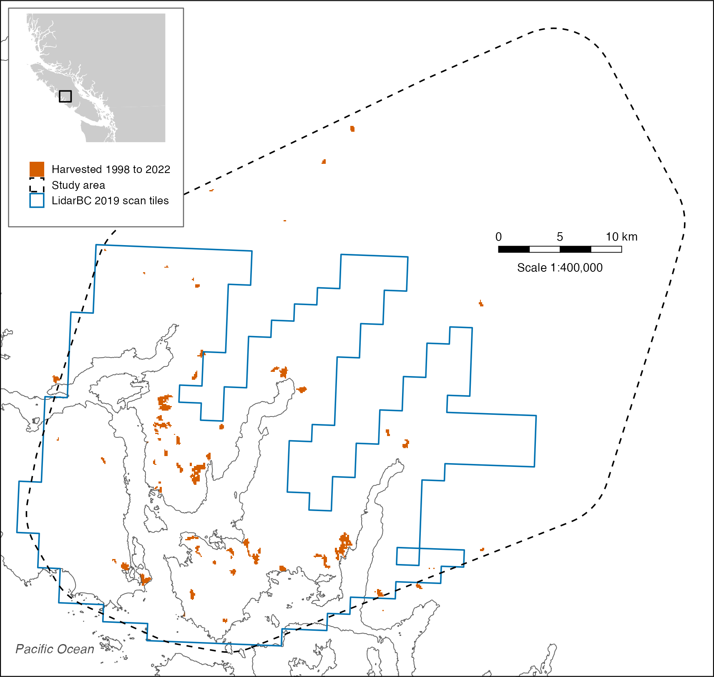
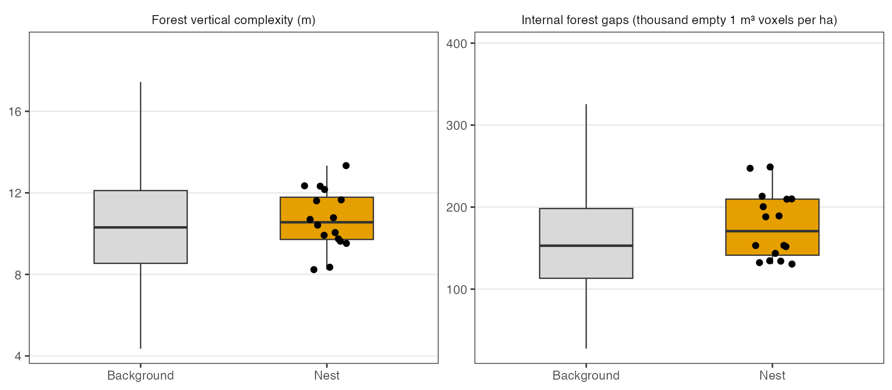

```{r}
#| label: setup
#| echo: !expr '!knitr::pandoc_to("docx")'
#| output: false
# Rendering this document runs the whole analysis. Every table and figure is written
# by a chunk below into 03.outputs, and every number in the prose is read back from
# those files by inline R, so the text cannot drift from the results. The code is
# printed in the html render and left out of the Word render.
library(knitr)
knitr::opts_hooks$set(echo = \(options) { if (knitr::pandoc_to("docx")) options$echo <- FALSE; options })
knitr::opts_chunk$set(echo = TRUE, warning = FALSE, message = FALSE)

repo <- normalizePath("..")
INP  <- file.path(repo, "02.inputs")
TBL  <- file.path(repo, "03.outputs", "tables")
FIG  <- file.path(repo, "03.outputs", "figures")
dir.create(TBL, recursive = TRUE, showWarnings = FALSE)
dir.create(FIG, recursive = TRUE, showWarnings = FALSE)

tbl <- function(f) read.csv(file.path(TBL, f))
fmt <- \(x, d = 2) formatC(x, format = "f", digits = d, big.mark = ",")
pv <- \(p) if (p < 0.001) "*P* < 0.001" else paste0("*P* = ", fmt(p))
ev <- \(what, col = "value", m = "local") { t <- tbl("T4_evaluation.csv"); t[[col]][t$model == m & t$metric == what] }
sep <- \(what, col) { t <- tbl("T3_separability.csv"); t[[col]][t$measure == what] }
smp <- \(what) { t <- tbl("T2_sample.csv"); t$n[t$step == what] }
acc <- \(cls) if (cls == "nest") 100 * ev("Nest cells above threshold") / ev("Nest cells") else 100 * (1 - ev("Background cells above threshold") / ev("Background cells"))

# Run `code` only when `path` is missing, so a render rebuilds an output that was
# deleted and leaves a finished one alone. Delete the file to force a rebuild.
build_once <- function(path, code) {
  if (!file.exists(path)) force(code)
  invisible(path)
}
```

# Abstract {.unnumbered}

Provincial airborne laser scans flown in 2019 measured old-growth forest structure across Clayoquot Sound, British Columbia, but the only Marbled Murrelet nesting-habitat model built from such scans and located nests, trained in Desolation Sound, lost accuracy when transferred there. Whether a model built from Clayoquot Sound's own nests would do better was unknown. This study rebuilt that model from the 2019 scans and the nests of birds radio-tracked from 2000 to 2002 (`r smp("nest cells in available forest")` nest cells and `r fmt(smp("background cells in available forest"), 0)` background cells of 1 ha in tall, unharvested forest). Maximum entropy modeling of forest vertical complexity and internal forest gaps was scored by five-fold spatial cross-validation in 10 km blocks. Neither measure separated nest cells from background cells (forest vertical complexity, `r pv(sep("fvc", "p_value"))`; internal forest gaps, `r pv(sep("empty_gaps", "p_value"))`), and nest cells had more internal gaps than background cells, the reverse of the Desolation Sound relation. The model classed `r fmt(acc("nest"), 1)` percent of held-out nest cells and `r fmt(acc("background"), 1)` percent of background cells correctly, an average accuracy of `r fmt((acc("nest") + acc("background")) / 2, 1)` percent and no better than chance. Its ranking of nest cells could not be shown to differ from that of the model transferred from Desolation Sound. With so few located nests, the transferred model, or one fitted to nests pooled across regions, remained the better-supported basis for mapping nesting habitat in Clayoquot Sound.

# Keywords {.unnumbered}

Airborne laser scanning; *Brachyramphus marmoratus*; habitat suitability; lidar; MaxEnt; model transferability; old-growth forest

# Introduction

The Marbled Murrelet, *Brachyramphus marmoratus* (Gmelin, 1789), is a seabird that nests inland in old-growth coniferous forest. It was listed as threatened in Canada and the United States, and loss of that forest was the primary reason given for its decline [@burger2001using]. Because its nests were cryptic and difficult to locate [@burger2001using], the nesting habitat retained for it in British Columbia was mapped from forest inventory, air photographs and aerial surveys and judged against the few nests found by radio telemetry [@mather2010marbled; @burger2018reliability].

The provincial habitat model classed forest-cover polygons as suitable by stand age, height, elevation and distance to the sea [@mather2010marbled]. Against 171 radio-tracked nests, it placed 52.6 percent in suitable habitat, 69.4 percent in Clayoquot Sound and 52.1 percent in Desolation Sound [@burger2018reliability]. Air photo interpretation and low-level aerial surveys ranked stands by canopy features seen from above [@waterhouse2008using; @burger2009new], and the survey ranks separated nests from random points in Desolation Sound and Toba Inlet but not in Clayoquot Sound [@waterhouse2009using]. All of these methods inferred forest structure from maps or from observers' ranks rather than measuring it.

Airborne laser scanning measured canopy height and the vertical arrangement of vegetation directly, and murrelet models built from it scored well against survey data. In southwestern Oregon, a lidar model of stand occupancy reached an area under the receiver operating characteristic curve (AUC), on which 0.5 marks chance, of 0.74, against 0.64 for a model built from vegetation maps [@hagar2014modeling]. Laser-scan measures of tall treetops predicted habitat suitability in redwood timberland in northern California [@lamphear2025marbled], and canopy and terrain measures predicted helicopter survey ranks on northern Vancouver Island with an overall accuracy of 71.05 percent [@clyde2017fine].

Among the studies reviewed here, Cosgrove et al. [-@cosgrove2024modeling] were the first to train a laser-scan model on located nests in British Columbia, fitting maximum entropy modeling (MaxEnt) to radio-tracked nests in Desolation Sound in 1 ha cells. Predicted suitability rose with forest vertical complexity, the spread of point heights, and fell with internal forest gaps, the empty space below the top of the canopy. The model scored an AUC of 0.77 and a Boyce index, a measure of how closely predicted suitability tracked nest frequency, of 0.99 in Desolation Sound. Transferred to Clayoquot Sound, it scored 0.63 and 0.67, below the AUC of 0.7 those authors set for a good model. In Oregon, a lidar occupancy model transferred from the Coos Bay District to the Siuslaw National Forest scored an AUC of 0.73, against 0.78 for a model selected from Siuslaw data [@hagar2018modeling]. In the two sounds, ground plots at radio-tracked nests showed canopy height and complexity relating to nest sites in opposite directions, and Silvergieter and Lank [-@silvergieter2011patch, 11] judged that "the limited size of our dataset and strong regional interactions precluded" testing Desolation Sound models against Clayoquot Sound nests.

No study in this review had built a laser-scan model from Clayoquot Sound nests. The provincial scans flown there in 2019 and the public release of the nest locations [@cooke2022marbled] made it possible to test whether a model built from local nests would outperform one transferred from Desolation Sound. The objectives of this study were to (1) rebuild the two-measure model of Cosgrove et al. [-@cosgrove2024modeling] from Clayoquot Sound nests and open laser scans and score it on spatially separate groups of nests, and (2) compare that score with that of the Desolation Sound model transferred to Clayoquot Sound. @tbl-attributes gives the expected direction of each measure and its source.

```{r}
#| label: tbl-attributes
#| tbl-cap: "Laser-scan measures entered in the model, with the direction of their relation to nest sites expected from prior work."
readr::read_csv("../02.inputs/derived/review-attributes.csv", show_col_types = FALSE) |>
  dplyr::transmute(Measure = measure, `Expected direction` = expected_direction, Reasoning = reasoning, Source = paste0("[", gsub("; ", "; @", paste0("@", citation)), "]")) |>
  knitr::kable(format = "pipe")
```

# Methods

## Study area

Clayoquot Sound, on the west coast of Vancouver Island, British Columbia (@fig-study-area), supported one of the highest concentrations of breeding Marbled Murrelets south of Alaska, including more than 10 percent of the estimated provincial population [@burger2001using]. The study area was the smallest convex polygon around the nests, widened by 5 km.

## Literature review

```{r}
#| label: review-terms
#| echo: true
if (!file.exists("../04.references/review/search-terms.csv")) {
  front <- rmarkdown::yaml_front_matter(knitr::current_input())
  small <- c("a", "an", "and", "as", "at", "by", "do", "does", "for", "from", "how", "in", "into", "is", "its", "of", "on", "or", "the", "to", "under", "using", "versus", "what", "why", "with")
  phrases <- \(x) x |>
    stringr::str_to_lower() |>
    stringr::str_remove_all("[*_]") |>
    stringr::str_replace_all("[^[:alnum:][:space:]-]", " | ") |>
    stringr::str_replace_all(paste0("\\b(", paste(small, collapse = "|"), ")\\b"), " | ") |>
    stringr::str_split_1("\\|") |>
    stringr::str_squish() |>
    purrr::keep(\(p) nchar(p) > 2)
  dir.create("../04.references/review", recursive = TRUE, showWarnings = FALSE)
  dplyr::bind_rows(
    tibble::tibble(term = stringr::str_squish(stringr::str_to_lower(unlist(stringr::str_split(unlist(front$keywords), "[;,]")))), source = "keywords"),
    tibble::tibble(term = phrases(front$title), source = "title"),
    tibble::tibble(term = phrases(front$subtitle %||% ""), source = "subtitle")
  ) |>
    dplyr::distinct(term, .keep_all = TRUE) |>
    dplyr::mutate(question = NA, concept = NA) |>
    readr::write_csv("../04.references/review/search-terms.csv", na = "")
}
```

```{r}
#| label: review-queries
#| echo: true
front <- rmarkdown::yaml_front_matter(knitr::current_input())
declared <- paste(front$title, front$subtitle, paste(unlist(front$keywords), collapse = " ")) |>
  stringr::str_remove_all("[*_]") |>
  stringr::str_to_lower()
term_regex <- \(x) if (stringr::str_ends(x, "\\*")) paste0("\\b", stringr::str_escape(stringr::str_remove(x, "\\*$"))) else paste0("\\b", stringr::str_escape(x), "\\b")
terms <- readr::read_csv("../04.references/review/search-terms.csv", col_types = readr::cols(.default = "c")) |>
  dplyr::filter(!is.na(question), !is.na(concept)) |>
  dplyr::mutate(term = stringr::str_to_lower(term)) |>
  tidyr::separate_longer_delim(question, " ")
stray <- terms$term[!purrr::map_lgl(terms$term, \(x) stringr::str_detect(declared, term_regex(x)))]
if (nrow(terms) == 0) stop("No search terms selected in 04.references/review/search-terms.csv")
if (length(stray) > 0) stop("Not in the title, subtitle or keywords: ", paste(unique(stray), collapse = ", "))
queries <- terms |>
  dplyr::summarise(.by = c(question, concept), group = paste(term, collapse = "|")) |>
  dplyr::summarise(.by = question, route = paste(c(dplyr::first(question), concept), collapse = "-"), concepts = paste(group, collapse = " AND "))
```

```{r}
#| label: review-store
#| echo: true
if (!file.exists("../02.inputs/derived/review-store-hits.csv")) {
  # library-science manifest, https://github.com/seamusrobertmurphy/library-science/blob/main/library/manifest.csv
  manifest <- readr::read_csv("../../library-science/library/manifest.csv", show_col_types = FALSE)
  # library-science source notes, https://github.com/seamusrobertmurphy/library-science/tree/main/sources
  notes <- tibble::tibble(path = list.files("../../library-science/sources", "\\.md$", full.names = TRUE)) |>
    dplyr::mutate(key = tools::file_path_sans_ext(basename(path)), note = purrr::map_chr(path, \(p) paste(readLines(p, warn = FALSE), collapse = " ")))
  store <- manifest |>
    dplyr::filter(status %in% c("verified", "filed", "unverified"), !is.na(title) | !is.na(key)) |>
    dplyr::left_join(dplyr::select(notes, key, note), by = "key") |>
    dplyr::mutate(text = stringr::str_to_lower(paste(title, note)))
  hits <- queries |>
    purrr::pmap(\(question, route, concepts) {
      groups <- stringr::str_split_1(concepts, " AND ")
      term <- \(x) if (stringr::str_ends(x, "\\*")) paste0(stringr::str_remove(x, "\\*$"), "\\w*") else paste0(x, "\\b")
      patterns <- purrr::map_chr(groups, \(g) paste0("\\b(", paste(purrr::map_chr(stringr::str_split_1(g, "\\|"), term), collapse = "|"), ")"))
      keep <- purrr::map(patterns, \(r) stringr::str_detect(store$text, r)) |> purrr::reduce(`&`)
      store[keep, ] |> dplyr::transmute(question, route = paste0("store-", route), key, doi, title, year, venue = container, source_note = dplyr::if_else(has_source_note == "yes", key, NA))
    }) |>
    purrr::list_rbind()
  readr::write_csv(hits, "../02.inputs/derived/review-store-hits.csv")
  queries |>
    dplyr::transmute(strand = "library-science", route = paste0("store-", route), query = concepts, date = as.character(Sys.Date())) |>
    dplyr::left_join(dplyr::count(hits, route, name = "retrieved"), by = "route") |>
    dplyr::mutate(retrieved = tidyr::replace_na(retrieved, 0L), reported_total = retrieved, cap = NA, capped = FALSE, error = NA) |>
    readr::write_csv("../02.inputs/derived/review-search-log.csv")
}
```

```{r}
#| label: review-semantic-scholar
#| echo: true
if (!file.exists("../02.inputs/derived/review-s2-hits.csv")) {
  search_s2 <- function(question, route, concepts, cap = 3000) {
    query <- stringr::str_split_1(concepts, " AND ") |>
      purrr::map_chr(\(g) paste0("(", paste(purrr::map_chr(stringr::str_split_1(g, "\\|"), \(x) if (grepl(" ", x)) paste0('"', x, '"') else x), collapse = " | "), ")")) |>
      paste(collapse = " + ")
    papers <- list(); token <- NULL; total <- NA
    repeat {
      # Semantic Scholar Academic Graph bulk search, https://api.semanticscholar.org/api-docs/graph#tag/Paper-Data/operation/get_graph_paper_bulk_search
      body <- httr2::request("https://api.semanticscholar.org/graph/v1/paper/search/bulk") |>
        httr2::req_url_query(query = query, fields = "title,year,venue,externalIds,citationCount,publicationTypes", token = token) |>
        httr2::req_retry(max_tries = 6) |>
        httr2::req_perform() |>
        httr2::resp_body_json()
      total <- body$total; token <- body$token
      papers <- c(papers, body$data)
      if (is.null(token) || length(papers) >= cap) break
    }
    works <- papers |>
      purrr::map(\(w) tibble::tibble(doi = w$externalIds$DOI %||% NA_character_, title = w$title %||% NA_character_, year = w$year %||% NA_integer_, venue = w$venue %||% NA_character_, type = paste(unlist(w$publicationTypes), collapse = " "), citations = w$citationCount %||% NA_integer_)) |>
      purrr::list_rbind()
    list(hits = dplyr::mutate(works, question, route = paste0("s2-", route), .before = 1),
         log = tibble::tibble(strand = "semantic-scholar", route = paste0("s2-", route), query, date = as.character(Sys.Date()), retrieved = nrow(works), reported_total = total, cap, capped = total > cap, error = NA))
  }
  runs <- purrr::pmap(queries, search_s2)
  readr::write_csv(purrr::map(runs, "hits") |> purrr::list_rbind(), "../02.inputs/derived/review-s2-hits.csv")
  readr::read_csv("../02.inputs/derived/review-search-log.csv", col_types = readr::cols(.default = "c")) |>
    dplyr::bind_rows(purrr::map(runs, "log") |> purrr::list_rbind() |> dplyr::mutate(dplyr::across(dplyr::everything(), as.character))) |>
    readr::write_csv("../02.inputs/derived/review-search-log.csv")
}
```

```{r}
#| label: review-records
#| echo: true
if (!file.exists("../02.inputs/derived/review-records.csv")) {
  dplyr::bind_rows(
    readr::read_csv("../02.inputs/derived/review-store-hits.csv", col_types = readr::cols(.default = "c")),
    readr::read_csv("../02.inputs/derived/review-s2-hits.csv", col_types = readr::cols(.default = "c"))
  ) |>
    dplyr::mutate(id = dplyr::coalesce(stringr::str_to_lower(doi), stringr::str_squish(stringr::str_to_lower(stringr::str_replace_all(title, "[^[:alnum:] ]", " "))))) |>
    dplyr::summarise(.by = id, doi = dplyr::first(stats::na.omit(doi)), title = dplyr::first(title), year = dplyr::first(stats::na.omit(year)), venue = dplyr::first(stats::na.omit(venue)), questions = paste(sort(unique(question)), collapse = " "), routes = paste(sort(unique(route)), collapse = " "), duplicates_merged = dplyr::n(), key = dplyr::first(stats::na.omit(key)), source_note = dplyr::first(stats::na.omit(source_note))) |>
    dplyr::mutate(decision = NA, reason = NA, full_text = NA) |>
    readr::write_csv("../02.inputs/derived/review-records.csv", na = "")
}
```

```{r}
#| label: review-chase
#| echo: true
central <- c("10.5751/ace-02585-190105", "10.3133/ofr20181035", "10.1002/wsb.407", "10.5751/ACE-00483-060206", "10.22230/jem.2018v18n1a593")
if (length(central) > 0 && !file.exists("../02.inputs/derived/review-chase-hits.csv")) {
  chase <- function(seed_doi, direction) {
    # Semantic Scholar Academic Graph references and citations, https://api.semanticscholar.org/api-docs/graph#tag/Paper-Data
    resp <- httr2::request(paste0("https://api.semanticscholar.org/graph/v1/paper/DOI:", seed_doi, "/", direction)) |>
      httr2::req_url_query(fields = "title,year,venue,externalIds", limit = 1000) |>
      httr2::req_retry(max_tries = 6) |>
      httr2::req_error(is_error = \(r) FALSE) |>
      httr2::req_perform()
    if (httr2::resp_status(resp) != 200) return(tibble::tibble(seed = seed_doi, route = paste0("chase-", direction), error = httr2::resp_status_desc(resp)))
    key <- if (direction == "references") "citedPaper" else "citingPaper"
    httr2::resp_body_json(resp)$data |>
      purrr::map(\(w) tibble::tibble(doi = w[[key]]$externalIds$DOI %||% NA_character_, title = w[[key]]$title %||% NA_character_, year = w[[key]]$year %||% NA_integer_, venue = w[[key]]$venue %||% NA_character_)) |>
      purrr::list_rbind() |>
      dplyr::mutate(seed = seed_doi, route = paste0("chase-", direction), .before = 1)
  }
  tidyr::expand_grid(seed_doi = central, direction = c("references", "citations")) |>
    purrr::pmap(chase) |>
    purrr::list_rbind() |>
    readr::write_csv("../02.inputs/derived/review-chase-hits.csv")
}
```

```{r}
#| label: review-counts
#| echo: true
records <- readr::read_csv("../02.inputs/derived/review-records.csv", show_col_types = FALSE)
search_log <- readr::read_csv("../02.inputs/derived/review-search-log.csv", show_col_types = FALSE)
review_counts <- tibble::tibble(
  Stage = c("Records retrieved", "Unique after removing duplicates", "Excluded on title and abstract", "Retained", "Read in full", "Full text not reached"),
  Records = c(sum(search_log$retrieved), nrow(records), sum(records$decision == "exclude" & dplyr::coalesce(records$full_text, "") != "yes"), sum(records$decision == "include"), sum(records$full_text == "yes", na.rm = TRUE), sum(records$full_text == "no", na.rm = TRUE))
)
rc <- \(stage) review_counts$Records[review_counts$Stage == stage]
review_reasons <- records |>
  dplyr::filter(decision == "exclude") |>
  dplyr::count(reason, name = "Records", sort = TRUE)
```

The literature review followed a protocol fixed on 28 September 2026, before the first search. A curated reference library and Semantic Scholar were searched for Marbled Murrelet with airborne laser scanning or lidar, with habitat suitability, MaxEnt or transferability, and with Clayoquot Sound. One round of backward and forward citation chasing was then run from five central records. Records were retained if they were

1. peer-reviewed articles, reviews, chapters, conference papers or agency reports supplying a method, threshold or data product,
2. published in English from 1990 to 2026, and
3. concerned with laser-scan measures at nest sites, nesting-habitat models and their transfer, or nesting habitat in Clayoquot Sound.

Of `r rc("Records retrieved")` records retrieved, `r rc("Unique after removing duplicates")` were unique, `r rc("Excluded on title and abstract")` were excluded on title and abstract and `r rc("Retained")` were retained, of which `r rc("Read in full")` were read in full. The other `r rc("Full text not reached")` could not be reached, among them unpublished reports and a thesis from the 1990s and journal articles behind paywalls. Every quotation taken from the records read was checked word for word against the source by a script.

## Nest data

From 2000 to 2002, Marbled Murrelets captured at sea were radio-tracked to their nests in Clayoquot Sound [@cosgrove2024modeling]. The published data set listed `r smp("nests in file")` nests confirmed on the ground, with a positional error of about 50 m [@cooke2022marbled]. No nest location was mapped in this paper.

```{r}
#| label: nests
# Marbled Murrelets at Clayoquot Sound, British Columbia, Canada (2000-2002), CS_nests.csv
# https://doi.org/10.5441/001/1.kg210889
build_once("../02.inputs/movebank/CS_nests.csv", curl::curl_download(
  "https://datarepository.movebank.org/server/api/core/bitstreams/1504af80-ae53-4e69-a6f6-3b2ce5d53958/content",
  "../02.inputs/movebank/CS_nests.csv"))
nests <- readr::read_csv("../02.inputs/movebank/CS_nests.csv", show_col_types = FALSE) |>
  sf::st_as_sf(coords = c("Long", "Lat"), crs = 4326) |>
  sf::st_transform(3157)
```

## Laser scans

```{r}
#| label: tiles
# LidarBC Open LiDAR Data Index, point cloud layer
# https://services6.arcgis.com/ubm4tcTYICKBpist/arcgis/rest/services/LiDAR_BC_S3_Public/FeatureServer/4
build_once("../02.inputs/lidarbc/tiles.gpkg", {
  area <- nests |> sf::st_union() |> sf::st_convex_hull() |> sf::st_buffer(5000)
  query <- paste0(
    "https://services6.arcgis.com/ubm4tcTYICKBpist/arcgis/rest/services/LiDAR_BC_S3_Public/",
    "FeatureServer/4/query?where=year%3D2019&geometryType=esriGeometryEnvelope&inSR=4326",
    "&outFields=filename,s3Url&f=geojson&geometry=",
    area |> sf::st_transform(4326) |> sf::st_bbox() |> paste(collapse = ","))
  set.seed(2019)
  purrr::map(0:5, \(i) sf::read_sf(paste0(query, "&resultOffset=", i * 1000))) |>
    dplyr::bind_rows() |>
    sf::st_transform(3157) |>
    dplyr::filter(lengths(sf::st_intersects(sf::st_centroid(geometry), area)) > 0) |>
    dplyr::mutate(
      nest = lengths(sf::st_intersects(geometry, sf::st_buffer(nests, 150))) > 0,
      background = dplyr::row_number() %in% sample(which(!nest), 40)) |>
    sf::write_sf("../02.inputs/lidarbc/tiles.gpkg")
})
tiles <- sf::read_sf("../02.inputs/lidarbc/tiles.gpkg")
```

```{r}
#| label: laz
# LidarBC 2019 point clouds, https://lidar.gov.bc.ca/
dir.create("../02.inputs/lidarbc/laz", showWarnings = FALSE)
tiles |>
  sf::st_drop_geometry() |>
  dplyr::filter(nest | background) |>
  purrr::pwalk(\(filename, s3Url, ...) {
    laz <- file.path("../02.inputs/lidarbc/laz", filename)
    build_once(laz, curl::curl_download(s3Url, laz))
  })
```

```{r}
#| label: thin
dir.create("../02.inputs/derived/thin", recursive = TRUE, showWarnings = FALSE)
list.files("../02.inputs/lidarbc/laz", "laz$") |>
  purrr::walk(\(f) build_once(file.path("../02.inputs/derived/thin", f), {
    h <- lidR::readLASheader(file.path("../02.inputs/lidarbc/laz", f))
    keep <- min(1, 15 * (h$`Max X` - h$`Min X`) * (h$`Max Y` - h$`Min Y`) /
      h$`Number of point records`)
    las <- lidR::readLAS(file.path("../02.inputs/lidarbc/laz", f), select = "xyzc",
        filter = paste("-drop_class 7 -drop_withheld -keep_random_fraction", keep)) |>
      lidR::decimate_points(lidR::homogenize(12, 10))
    if (!lidR::is.empty(las)) {
      lidR::writeLAS(las, file.path("../02.inputs/derived/thin", f))
      rlas::writelax(file.path("../02.inputs/derived/thin", f))
    }
  }))
```

Point clouds came from the 2019 Vancouver Island acquisition of LidarBC, the open lidar program of the Province of British Columbia, and only nests inside that acquisition were used. Of the `r nrow(tiles)` tiles centered in the study area, the `r sum(tiles$nest)` within 150 m of a nest and `r sum(tiles$background)` drawn at random from the rest were used. Points classed as noise or withheld were dropped, and each tile was thinned at random and evened to 12 points per square meter in 10 m cells, so that point density did not differ between nest and background tiles.

## Harvest screen

Forest harvested from 1998 to 2022 was screened out with the Canada Forest Harvest 1985–2022 product of the National Terrestrial Ecosystem Monitoring System, which records the year of stand-replacing harvest on a 30 m grid [@hermosilla2016mass].

```{r}
#| label: ntems
# Canada Forest Harvest 1985-2022, National Terrestrial Ecosystem Monitoring System
# https://opendata.nfis.org/downloads/forest_change/CA_Forest_Harvest_1985-2022.zip
build_once("../02.inputs/ntems/harvest_cs.tif", {
  curl::curl_download(
    "https://opendata.nfis.org/downloads/forest_change/CA_Forest_Harvest_1985-2022.zip",
    "../02.inputs/ntems/CA_Forest_Harvest_1985-2022.zip")
  unzip("../02.inputs/ntems/CA_Forest_Harvest_1985-2022.zip", exdir = "../02.inputs/ntems")
  harvest <- list.files("../02.inputs/ntems", "\\.tif$", recursive = TRUE, full.names = TRUE)[1] |>
    terra::rast()
  terra::crop(harvest, tiles |> sf::st_transform(terra::crs(harvest)) |> terra::vect(),
    filename = "../02.inputs/ntems/harvest_cs.tif")
})
```

```{r}
#| label: fig-study-area
#| fig-cap: !expr paste0("Clayoquot Sound on the west coast of Vancouver Island, British Columbia. The dashed line bounds the study area, drawn 5 km around the radio-tracked nests, the blue line bounds the ", nrow(tiles), " LidarBC scan tiles flown in 2019, each about ", round(mean(as.numeric(sf::st_area(tiles))) / 1e6, 1), " km², and orange marks forest harvested from 1998 to 2022. Nest locations are not shown. The inset places the study area on Vancouver Island. Scale 1:400,000.")
# Freshwater Atlas Coastlines, Province of British Columbia
# https://catalogue.data.gov.bc.ca/dataset/freshwater-atlas-coastlines
dir.create("../02.inputs/fwa", showWarnings = FALSE)
build_once("../02.inputs/fwa/coastline.gpkg", sf::read_sf("https://openmaps.gov.bc.ca/geo/pub/wfs?service=WFS&version=2.0.0&request=GetFeature&typeNames=pub:WHSE_BASEMAPPING.FWA_COASTLINES_SP&outputFormat=application/json&srsName=EPSG:3157&bbox=980000,460000,1045000,525000,urn:ogc:def:crs:EPSG::3005") |> sf::write_sf("../02.inputs/fwa/coastline.gpkg"))
build_once("../03.outputs/figures/F1_study_area.png", {
  frame <- sf::st_bbox(c(xmin = 266000, ymin = 5454000, xmax = 324000, ymax = 5509000), crs = 3157)
  coast <- sf::read_sf("../02.inputs/fwa/coastline.gpkg")
  # Natural Earth 1:10 million admin 0 countries, read through the rnaturalearthhires package
  # https://www.naturalearthdata.com/downloads/10m-cultural-vectors/10m-admin-0-countries/
  land <- rnaturalearth::ne_countries(scale = 10, country = c("Canada", "United States of America"), returnclass = "sf") |> sf::st_transform(3157)
  harvest <- terra::rast("../02.inputs/ntems/harvest_cs.tif") |> terra::project("EPSG:3157", method = "near", res = 30) |> terra::aggregate(3, fun = "max") |> (\(r) r >= 1998)() |> terra::as.data.frame(xy = TRUE) |> dplyr::filter(dplyr::if_any(3))
  area <- nests |> sf::st_union() |> sf::st_convex_hull() |> sf::st_buffer(5000)
  main <- ggplot2::ggplot() +
    ggplot2::geom_tile(data = harvest, ggplot2::aes(x, y, fill = "Harvested 1998 to 2022"), width = 90, height = 90) +
    ggplot2::geom_sf(data = coast, colour = "grey35", linewidth = 0.2) +
    ggplot2::geom_sf(data = sf::st_union(tiles), ggplot2::aes(colour = "LidarBC 2019 scan tiles"), fill = NA, linewidth = 0.4) +
    ggplot2::geom_sf(data = area, ggplot2::aes(linetype = "Study area"), fill = NA, colour = "black", linewidth = 0.4) +
    ggplot2::scale_fill_manual(NULL, values = "#D55E00") + ggplot2::scale_colour_manual(NULL, values = "#0072B2") + ggplot2::scale_linetype_manual(NULL, values = "dashed") +
    ggplot2::annotate("text", x = 267200, y = 5456300, label = "Pacific Ocean", hjust = 0, fontface = "italic", size = 2.6, colour = "grey30") +
    ggplot2::annotate("rect", xmin = 306500 + c(0, 2500, 5000, 7500), xmax = 306500 + c(2500, 5000, 7500, 10000), ymin = 5488500, ymax = 5489000, fill = c("black", "white", "black", "white"), colour = "black", linewidth = 0.2) +
    ggplot2::annotate("text", x = 306500 + c(0, 5000, 10000), y = 5489800, label = c("0", "5", "10 km"), size = 2.4) +
    ggplot2::annotate("text", x = 311500, y = 5487300, label = "Scale 1:400,000", size = 2.4) +
    ggplot2::coord_sf(crs = 3157, xlim = frame[c(1, 3)], ylim = frame[c(2, 4)], expand = FALSE, datum = NA) +
    ggplot2::theme_void(base_size = 8) +
    ggplot2::theme(panel.border = ggplot2::element_rect(fill = NA, colour = "black", linewidth = 0.5), panel.background = ggplot2::element_rect(fill = "white", colour = NA), legend.position = "none", plot.margin = ggplot2::margin(0, 0, 0, 0))
  key <- cowplot::get_plot_component(main + ggplot2::theme(legend.position = "right", legend.spacing.y = grid::unit(0, "pt"), legend.margin = ggplot2::margin(0, 0, 0, 0), legend.key.size = grid::unit(9, "pt")), "guide-box-right")
  locator <- ggplot2::ggplot() +
    ggplot2::geom_sf(data = land, fill = "grey80", colour = NA) +
    ggplot2::geom_sf(data = sf::st_as_sfc(frame), fill = NA, colour = "black", linewidth = 0.4) +
    ggplot2::coord_sf(crs = 3157, xlim = c(100000, 800000), ylim = c(5250000, 5900000), expand = FALSE, datum = NA) +
    ggplot2::theme_void() + ggplot2::theme(panel.background = ggplot2::element_rect(fill = "white", colour = NA))
  fig <- cowplot::ggdraw(main) +
    cowplot::draw_grob(grid::rectGrob(gp = grid::gpar(fill = "white", col = "grey40", lwd = 0.8)), x = 0.012, y = 0.665, width = 0.245, height = 0.323) +
    cowplot::draw_plot(locator, x = 0.022, y = 0.79, width = 0.225, height = 0.19) +
    cowplot::draw_grob(key, x = 0.022, y = 0.672, width = 0.225, height = 0.11, hjust = 0, vjust = 0) +
    ggplot2::theme(plot.background = ggplot2::element_rect(fill = "white", colour = NA))
  ggplot2::ggsave("../03.outputs/figures/F1_study_area.png", fig, width = 58000 / 4e3, height = 55000 / 4e3, units = "cm", dpi = 300)
})

```

## Forest structure

Heights were normalized to the ground by a triangulated surface on ground points, and points below 0 m or at or above 100 m were discarded. Following the grid and definitions of Cosgrove et al. [-@cosgrove2024modeling], five measures were computed in 1 ha cells with lidR [@roussel2020lidr]. Forest vertical complexity was the standard deviation of point heights, and internal forest gaps were the number of empty 1 m³ voxels below the highest filled voxel of each 1 m column, summed over the cell. Forest height, the 95th percentile of point heights, canopy cover, the share of 1 m columns with a point, and point density were used only to define available forest.

```{r}
#| label: metrics
structure_metrics <- function(X, Y, Z) {
  voxels <- unique(data.table::data.table(x = floor(X), y = floor(Y), z = floor(Z)))
  columns <- voxels[, list(n = .N, top = max(z)), by = c("x", "y")]
  list(
    fh = quantile(Z, 0.95),
    fvc = sd(Z),
    empty_gaps = sum(columns$top + 1 - columns$n),
    cover = nrow(columns) / 1e4,
    density = length(Z) / 1e4)
}
build_once("../02.inputs/derived/metrics.tif", {
  ctg <- lidR::readLAScatalog("../02.inputs/derived/thin")
  lidR::opt_chunk_size(ctg) <- 1000
  lidR::opt_chunk_buffer(ctg) <- 20
  lidR::opt_chunk_alignment(ctg) <- c(0, 0)
  lidR::opt_stop_early(ctg) <- FALSE
  lidR::opt_progress(ctg) <- FALSE
  lidR::catalog_map(ctg, \(las) las |>
      lidR::normalize_height(lidR::tin()) |>
      lidR::filter_poi(Z >= 0, Z < 100) |>
      lidR::pixel_metrics(~structure_metrics(X, Y, Z), res = 100, start = c(0, 0))) |>
    terra::writeRaster("../02.inputs/derived/metrics.tif")
})
```

## Available forest

A cell was available forest if

1. forest height was at least 20 m,
2. canopy cover was at least 90 percent,
3. point density was at least 10 points per square meter, and
4. no 30 m pixel inside it was harvested from 1998 to 2022.

Nest cells were available-forest cells with a nest, and background cells were all available-forest cells in the background tiles (@tbl-sample). The nest sample was small, and the nests were found 17 to 19 years before the scans were flown.

```{r}
#| label: cells
metrics <- terra::rast("../02.inputs/derived/metrics.tif")
cells <- terra::rast("../02.inputs/ntems/harvest_cs.tif") |>
  (\(r) terra::project(r >= 1998, metrics, method = "max"))() |>
  stats::setNames("cut") |>
  c(metrics) |>
  terra::as.data.frame(xy = TRUE, cells = TRUE) |>
  dplyr::mutate(
    forest = dplyr::coalesce(fh >= 20 & cover >= 0.9 & density >= 10 & dplyr::coalesce(cut, 0) == 0, FALSE),
    nest = cell %in% terra::cellFromXY(metrics, sf::st_coordinates(nests)),
    background = !nest & lengths(sf::st_intersects(
      sf::st_as_sf(dplyr::pick(x, y), coords = c("x", "y"), crs = 3157),
      dplyr::filter(tiles, background))) > 0)
build_once("../03.outputs/tables/T2_sample.csv", tibble::tibble(
  step = c("nests in file", "nest cells scanned", "nest cells in available forest",
    "background cells scanned", "background cells in available forest"),
  n = c(nrow(nests), sum(cells$nest & !is.na(cells$fh)), sum(cells$nest & cells$forest),
    sum(cells$background & !is.na(cells$fh)), sum(cells$background & cells$forest))) |>
  readr::write_csv("../03.outputs/tables/T2_sample.csv"))
```

```{r}
#| label: tbl-sample
#| tbl-cap: "Nests and 1 ha cells at each step from the nest file to the modeled sample. Available forest was at least 20 m tall with at least 90% canopy cover and no harvest from 1998 to 2022."
tbl("T2_sample.csv") |>
  dplyr::transmute(Step = stringr::str_to_sentence(step), Count = formatC(n, format = "d", big.mark = ",")) |>
  flextable::flextable() |> flextable::align(j = 2, align = "right", part = "all") |> flextable::set_table_properties(layout = "autofit", width = 1)
```

## Model fitting

Following the top model of Cosgrove et al. [-@cosgrove2024modeling], MaxEnt was fitted to forest vertical complexity and internal forest gaps in the maxnet package [@phillips2017opening], with linear and product features and a regularization multiplier of 0.2. Predictions were taken on the complementary log-log scale. For spatial block cross-validation, cells were assigned to five folds by 10 km square blocks allocated at random [@valavi2019blockcv], and each fold was predicted by a model trained on the other four. Each model's classification threshold maximized the sum of sensitivity, the share of nest cells classed as nesting habitat, and specificity, the share of background cells classed as not, on its training cells [@liu2005selecting].

```{r}
#| label: model
sample <- cells |>
  dplyr::filter(forest, nest | background) |>
  dplyr::mutate(p = as.integer(nest))
folds <- sample |>
  sf::st_as_sf(coords = c("x", "y"), crs = 3157) |>
  blockCV::cv_spatial(column = "p", k = 5, size = 10000, selection = "random",
    seed = 2019, plot = FALSE, progress = FALSE, report = FALSE)
fit_maxent <- function(d) {
  x <- as.data.frame(d[c("fvc", "empty_gaps")])
  maxnet::maxnet(d$p, x, maxnet::maxnet.formula(d$p, x, classes = "lp"), regmult = 0.2)
}
score <- \(fit, d) predict(fit, as.data.frame(d[c("fvc", "empty_gaps")]), type = "cloglog")[, 1]
runs <- purrr::map(1:5, \(k) {
  train <- sample[folds$folds_ids != k, ]
  fit <- fit_maxent(train)
  threshold <- pROC::coords(pROC::roc(train$p, score(fit, train), quiet = TRUE), "best", ret = "threshold")$threshold[1]
  test <- sample[folds$folds_ids == k, ] |> dplyr::mutate(fold = k)
  list(test = dplyr::mutate(test, pred = score(fit, test), class = as.integer(pred >= threshold)), train_rmse = sqrt(mean((score(fit, train) - train$p)^2)))
})
held_out <- purrr::map(runs, "test") |> purrr::list_rbind()
```

## Separability

On each measure, the separability of nest and background cells was given by the index *M* of Kaufman and Remer [-@kaufman1994detection], the absolute difference between the two means divided by the sum of the two standard deviations. The difference was tested with a Wilcoxon rank-sum test, as in Cosgrove et al. [-@cosgrove2024modeling].

```{r}
#| label: separability
build_once("../03.outputs/tables/T3_separability.csv", sample |>
  tidyr::pivot_longer(c(fvc, empty_gaps), names_to = "measure") |>
  dplyr::summarise(.by = measure,
    nest_mean = mean(value[p == 1]), nest_sd = sd(value[p == 1]),
    nest_low = t.test(value[p == 1])$conf.int[1], nest_high = t.test(value[p == 1])$conf.int[2],
    background_mean = mean(value[p == 0]), background_sd = sd(value[p == 0]),
    background_low = t.test(value[p == 0])$conf.int[1], background_high = t.test(value[p == 0])$conf.int[2],
    m = abs(nest_mean - background_mean) / (nest_sd + background_sd),
    w = wilcox.test(value[p == 1], value[p == 0])$statistic,
    p_value = wilcox.test(value[p == 1], value[p == 0])$p.value) |>
  readr::write_csv("../03.outputs/tables/T3_separability.csv"))
```

## Evaluation

Held-out predictions were pooled across folds and scored with the measures of Murphy et al. [-@murphy2026spatial]. Discrimination was measured by AUC with a DeLong 95 percent confidence interval (CI) [@robin2011proc] and the continuous Boyce index [@hirzel2006evaluating]. Classification at each fold's threshold was summarized by sensitivity, specificity, overall accuracy with an exact binomial interval, Cohen's kappa and the commission and omission error of each class. Agreement between prediction and the observed 0 or 1 outcome was measured by root mean square error (RMSE), relative RMSE (RMSE over the mean outcome), mean absolute error, Brier score, the coefficient of determination (*R*²) of outcome on prediction with its *F* test. Theil's *U* bias gave the share of squared error due to the gap between mean prediction and mean outcome. Overfitting was measured by the RMSE ratio, held-out over training RMSE, with a model rejected above 1.1 [@murphy2026spatial], and residual autocorrelation by Moran's *I* with inverse-distance weights and the Durbin-Watson test on residuals ordered by easting. The model was compared with that of Cosgrove et al. [-@cosgrove2024modeling], in Desolation Sound and transferred to Clayoquot Sound, on the AUC and Boyce index those authors reported. Analyses were run in R `r getRversion()` [@rcore2024r] with lidR `r packageVersion("lidR")`, maxnet `r packageVersion("maxnet")`, blockCV `r packageVersion("blockCV")`, pROC `r packageVersion("pROC")` and ecospat `r packageVersion("ecospat")`.

```{r}
#| label: evaluation
roc <- pROC::roc(held_out$p, held_out$pred, quiet = TRUE)
auc <- pROC::ci.auc(roc)
cm <- table(predicted = factor(held_out$class, 0:1), observed = factor(held_out$p, 0:1))
n <- sum(cm); oa <- sum(diag(cm)) / n; pe <- sum(rowSums(cm) * colSums(cm)) / n^2
kappa <- (oa - pe) / (1 - pe); kappa_se <- sqrt(oa * (1 - oa) / (n * (1 - pe)^2))
e <- held_out$pred - held_out$p
r2 <- summary(lm(p ~ pred, held_out))
w <- 1 / as.matrix(dist(held_out[c("x", "y")])); diag(w) <- 0
moran <- ape::Moran.I(e, w)
dw <- lmtest::dwtest(p ~ pred, data = dplyr::arrange(held_out, x, y))
# Desolation Sound scores from Cosgrove et al. (2024), Avian Conservation and Ecology 19(1):5
# https://doi.org/10.5751/ACE-02585-190105
build_once("../03.outputs/tables/T4_evaluation.csv", tibble::tribble(
  ~model, ~metric, ~value, ~low, ~high, ~p_value,
  "local", "Nest cells", sum(held_out$p), NA, NA, NA,
  "local", "Background cells", sum(held_out$p == 0), NA, NA, NA,
  "local", "Nest cells above threshold", cm["1", "1"], NA, NA, NA,
  "local", "Background cells above threshold", cm["1", "0"], NA, NA, NA,
  "local", "Mean prediction", mean(held_out$pred), NA, NA, NA,
  "local", "Nest share of cells", mean(held_out$p), NA, NA, NA,
  "local", "F statistic", r2$fstatistic[1], r2$fstatistic[2], r2$fstatistic[3], NA,
  "local", "AUC", auc[2], auc[1], auc[3], NA,
  "local", "Boyce index", ecospat::ecospat.boyce(held_out$pred[held_out$p == 0], held_out$pred[held_out$p == 1], PEplot = FALSE)$cor, NA, NA, NA,
  "local", "Overall accuracy", oa, binom.test(sum(diag(cm)), n)$conf.int[1], binom.test(sum(diag(cm)), n)$conf.int[2], NA,
  "local", "Kappa", kappa, kappa - 1.96 * kappa_se, kappa + 1.96 * kappa_se, NA,
  "local", "Commission error, nest", cm["1", "0"] / sum(cm["1", ]), NA, NA, NA,
  "local", "Omission error, nest", cm["0", "1"] / sum(cm[, "1"]), NA, NA, NA,
  "local", "Commission error, background", cm["0", "1"] / sum(cm["0", ]), NA, NA, NA,
  "local", "Omission error, background", cm["1", "0"] / sum(cm[, "0"]), NA, NA, NA,
  "local", "R2", r2$r.squared, NA, NA, pf(r2$fstatistic[1], r2$fstatistic[2], r2$fstatistic[3], lower.tail = FALSE),
  "local", "RMSE", sqrt(mean(e^2)), NA, NA, NA,
  "local", "RMSE ratio", sqrt(mean(e^2)) / mean(purrr::map_dbl(runs, "train_rmse")), NA, NA, NA,
  "local", "Relative RMSE", sqrt(mean(e^2)) / mean(held_out$p), NA, NA, NA,
  "local", "MAE", mean(abs(e)), NA, NA, NA,
  "local", "Theil's U bias", (mean(held_out$pred) - mean(held_out$p))^2 / mean(e^2), NA, NA, NA,
  "local", "Brier score", mean(e^2), NA, NA, NA,
  "local", "Moran's I of residuals", moran$observed, NA, NA, moran$p.value,
  "local", "Durbin-Watson", unname(dw$statistic), NA, NA, dw$p.value,
  "desolation", "AUC", 0.77, NA, NA, NA,
  "desolation", "Boyce index", 0.99, NA, NA, NA,
  "transferred", "AUC", 0.63, NA, NA, NA,
  "transferred", "Boyce index", 0.67, NA, NA, NA) |>
  readr::write_csv("../03.outputs/tables/T4_evaluation.csv"))
```

```{r}
#| label: structure-figure
build_once("../03.outputs/figures/F2_structure.png", {
  fig <- sample |>
    dplyr::mutate(empty_gaps = empty_gaps / 1000, group = factor(ifelse(p == 1, "Nest", "Background"), c("Background", "Nest"))) |>
    tidyr::pivot_longer(c(fvc, empty_gaps), names_to = "measure") |>
    dplyr::mutate(measure = factor(measure, c("fvc", "empty_gaps"), c("Forest vertical complexity (m)", "Internal forest gaps (thousand empty 1 m³ voxels per ha)"))) |>
    ggplot2::ggplot(ggplot2::aes(group, value)) +
    ggplot2::geom_boxplot(ggplot2::aes(fill = group), outlier.shape = NA, width = 0.5, linewidth = 0.3) +
    ggplot2::geom_jitter(data = \(d) dplyr::filter(d, group == "Nest"), width = 0.12, height = 0, size = 1.2, colour = "black") +
    ggplot2::facet_wrap(~measure, scales = "free_y") +
    ggplot2::scale_fill_manual(values = c(Background = "grey85", Nest = "#E69F00"), guide = "none") +
    ggplot2::labs(x = NULL, y = NULL) +
    ggplot2::theme_bw(base_size = 8) + ggplot2::theme(strip.background = ggplot2::element_blank(), panel.grid.major.x = ggplot2::element_blank(), panel.grid.minor = ggplot2::element_blank())
  ggplot2::ggsave("../03.outputs/figures/F2_structure.png", fig, width = 16, height = 7, units = "cm", dpi = 300)
})
```

# Results

## Sample

The 2019 scans covered `r smp("nest cells scanned")` cells with a nest, of which `r smp("nest cells in available forest")` were available forest, against `r fmt(smp("background cells in available forest"), 0)` available-forest cells among the `r fmt(smp("background cells scanned"), 0)` scanned cells of the background tiles (@tbl-sample).

## Separability

Neither measure separated nest cells from background cells (@tbl-separability, @fig-structure). Forest vertical complexity averaged `r fmt(sep("fvc", "nest_mean"))` ± `r fmt(sep("fvc", "nest_sd"))` m (95 percent CI `r fmt(sep("fvc", "nest_low"))` to `r fmt(sep("fvc", "nest_high"))`) at nest cells and `r fmt(sep("fvc", "background_mean"))` ± `r fmt(sep("fvc", "background_sd"))` m (`r fmt(sep("fvc", "background_low"))` to `r fmt(sep("fvc", "background_high"))`) at background cells [*M* = `r fmt(sep("fvc", "m"))`, Wilcoxon rank-sum test, *W* = `r fmt(sep("fvc", "w"), 0)`, `r pv(sep("fvc", "p_value"))`]. Internal forest gaps were larger at nest cells, `r fmt(sep("empty_gaps", "nest_mean") / 1000, 1)` ± `r fmt(sep("empty_gaps", "nest_sd") / 1000, 1)` thousand empty voxels per hectare (`r fmt(sep("empty_gaps", "nest_low") / 1000, 1)` to `r fmt(sep("empty_gaps", "nest_high") / 1000, 1)`), than at background cells, `r fmt(sep("empty_gaps", "background_mean") / 1000, 1)` ± `r fmt(sep("empty_gaps", "background_sd") / 1000, 1)` thousand (`r fmt(sep("empty_gaps", "background_low") / 1000, 1)` to `r fmt(sep("empty_gaps", "background_high") / 1000, 1)`), the reverse of the negative relation found in Desolation Sound, although the difference was not significant [*M* = `r fmt(sep("empty_gaps", "m"))`, *W* = `r fmt(sep("empty_gaps", "w"), 0)`, `r pv(sep("empty_gaps", "p_value"))`].

```{r}
#| label: tbl-separability
#| tbl-cap: "Laser-scan measures at nest and background cells in available forest, as mean ± standard deviation (95% confidence interval), with the separability index M and the Wilcoxon rank-sum statistic W. Internal forest gaps are in thousands of empty 1 m³ voxels per ha. * P ≤ 0.05, ** P ≤ 0.01, *** P ≤ 0.001, **** P ≤ 0.0001."
star <- \(p) dplyr::case_when(is.na(p) ~ "", p <= 0.0001 ~ "****", p <= 0.001 ~ "***", p <= 0.01 ~ "**", p <= 0.05 ~ "*", TRUE ~ "")
tbl("T3_separability.csv") |>
  dplyr::mutate(k = ifelse(measure == "empty_gaps", 1000, 1), dplyr::across(nest_mean:background_high, \(x) x / k)) |>
  dplyr::transmute(Measure = ifelse(measure == "fvc", "Forest vertical complexity (m)", "Internal forest gaps"),
    Nest = paste0(fmt(nest_mean), " ± ", fmt(nest_sd), " (", fmt(nest_low), "–", fmt(nest_high), ")"),
    Background = paste0(fmt(background_mean), " ± ", fmt(background_sd), " (", fmt(background_low), "–", fmt(background_high), ")"),
    M = fmt(m), W = paste0(fmt(w, 0), star(p_value))) |>
  flextable::flextable() |> flextable::align(j = 2:5, align = "right", part = "body") |> flextable::align(align = "center", part = "header") |> flextable::set_table_properties(layout = "autofit", width = 1)
```

```{r}
#| label: fig-structure
#| fig-cap: !expr paste0("Forest vertical complexity and internal forest gaps at ", smp("nest cells in available forest"), " nest cells (points) and ", fmt(smp("background cells in available forest"), 0), " background cells in available forest, Clayoquot Sound. Boxes span the middle half of the values, the bar marks the median, and whiskers reach the furthest value within 1.5 box lengths.")

```

## Model evaluation

The Clayoquot Sound model discriminated nest cells from background cells no better than chance (@tbl-evaluation). Its AUC was `r fmt(ev("AUC"))` (95 percent CI `r fmt(ev("AUC", "low"))` to `r fmt(ev("AUC", "high"))`), against `r fmt(ev("AUC", m = "desolation"))` for the Desolation Sound model in its own area and `r fmt(ev("AUC", m = "transferred"))` for that model transferred to Clayoquot Sound, and its Boyce index was `r fmt(ev("Boyce index"))` against `r fmt(ev("Boyce index", m = "desolation"))` and `r fmt(ev("Boyce index", m = "transferred"))`. At the training thresholds, `r ev("Nest cells above threshold")` of `r ev("Nest cells")` held-out nest cells and `r fmt(ev("Background cells above threshold"), 0)` of `r fmt(ev("Background cells"), 0)` background cells were classed as nesting habitat, a sensitivity of `r fmt(acc("nest"), 1)` percent and a specificity of `r fmt(acc("background"), 1)` percent, for an average accuracy of `r fmt((acc("nest") + acc("background")) / 2, 1)` percent. Cohen's kappa, the agreement beyond chance, was `r fmt(ev("Kappa"))` (95 percent CI `r fmt(ev("Kappa", "low"))` to `r fmt(ev("Kappa", "high"))`).

The model did not overfit, its RMSE ratio of `r fmt(ev("RMSE ratio"))` lying below the rejection threshold of 1.1, but nearly all of its error was systematic [Theil's *U* bias = `r fmt(ev("Theil's U bias"))`], because predictions averaged `r fmt(ev("Mean prediction"))` while nest cells made up `r fmt(ev("Nest share of cells"), 3)` of all cells. Residuals were spatially autocorrelated [Moran's *I* = `r fmt(ev("Moran's I of residuals"))`, `r pv(ev("Moran's I of residuals", "p_value"))`].

```{r}
#| label: tbl-evaluation
#| tbl-cap: "Performance of the Clayoquot Sound model on held-out cells pooled over five spatial folds, beside the Desolation Sound model of Cosgrove et al. (2024) in its own area and transferred to Clayoquot Sound. Intervals are 95% confidence intervals. AUC is the area under the receiver operating characteristic curve, RMSE root mean square error and MAE mean absolute error. * P ≤ 0.05, ** P ≤ 0.01, *** P ≤ 0.001, **** P ≤ 0.0001."
show <- c("AUC" = "AUC", "Boyce index" = "Boyce index", "Overall accuracy" = "Overall accuracy", "Kappa" = "Kappa", "Commission error, nest" = "Commission error, nest", "Omission error, nest" = "Omission error, nest", "Commission error, background" = "Commission error, background", "Omission error, background" = "Omission error, background", "R2" = "R²", "RMSE" = "RMSE", "RMSE ratio" = "RMSE ratio", "Relative RMSE" = "Relative RMSE", "MAE" = "MAE", "Brier score" = "Brier score", "Theil's U bias" = "Theil's U bias", "Moran's I of residuals" = "Moran's I of residuals", "Durbin-Watson" = "Durbin-Watson")
tbl("T4_evaluation.csv") |>
  dplyr::filter(metric %in% names(show)) |>
  dplyr::mutate(cell = paste0(dplyr::if_else(metric == "R2", fmt(value, 5), fmt(value)), dplyr::if_else(is.na(low), "", paste0(" (", fmt(low), " to ", fmt(high), ")")), star(p_value))) |>
  tidyr::pivot_wider(id_cols = metric, names_from = model, values_from = cell, values_fill = "") |>
  dplyr::arrange(match(metric, names(show))) |>
  dplyr::transmute(Measure = show[metric], `Clayoquot Sound, local` = local, `Desolation Sound, own area` = desolation, `Desolation Sound, transferred` = transferred) |>
  flextable::flextable() |> flextable::align(j = 2:4, align = "right", part = "body") |> flextable::align(align = "center", part = "header") |> flextable::set_table_properties(layout = "autofit", width = 1)
```

# Discussion

In Clayoquot Sound, a MaxEnt model rebuilt from `r smp("nest cells in available forest")` local nest cells and open 2019 laser scans ranked held-out nest cells above background cells no more often than chance. The 95 percent interval on its AUC included both chance and the `r fmt(ev("AUC", m = "transferred"))` reached by the same model transferred from Desolation Sound [@cosgrove2024modeling]. The local model therefore did not outperform the transferred one, although these data could not show that it did worse. In Oregon, a locally selected lidar model also improved little on a transferred one, 0.78 against 0.73, but there the transferred model was already adequate on 772 surveyed stands [@hagar2018modeling].

The two measures did not relate to nest sites in Clayoquot Sound as they did in Desolation Sound. Internal forest gaps were larger at nest cells than at background cells, the reverse of the Desolation Sound relation [@cosgrove2024modeling], and forest vertical complexity hardly differed. Ground plots at 27 Clayoquot Sound and 37 Desolation Sound nests also showed opposite relations, with shorter and less varied canopy than at random sites in Clayoquot Sound but taller and more varied canopy in Desolation Sound [@silvergieter2011patch]. Nest trees in Clayoquot Sound exceeded other available trees in height by an average of 15 percent of total height, against 30 percent in Desolation Sound [@silvergieter2011marbled], a smaller contrast that a 1 ha summary of point heights would be less able to detect. If nest-site selection differed between the two sounds in this way, a model built on Desolation Sound relations would be expected to transfer poorly, as it did, and a model of the same form fitted in Clayoquot Sound would have little to separate.

The background cells may explain much of the weak result, because `r fmt(100 * smp("background cells in available forest") / smp("background cells scanned"), 0)` percent of the scanned background cells met the definition of available forest, so nest cells were compared with forest of much the same kind. Waterhouse et al. [-@waterhouse2009using] gave the same reason for the failure of aerial survey ranks in Clayoquot Sound, which "has more uniform coverage of suitable forest (Zharikov et al. 2006); consequently a higher proportion of random points might fall within suitable nesting habitat, thereby minimizing the differences between nests and random points" [@waterhouse2009using, 90]. The features that decided which stand a bird used may also have gone unmeasured by a 1 ha summary of point heights. Silvergieter and Lank [-@silvergieter2011patch], who modeled nest-site selection with resource selection functions (RSF), noted that "relative numbers of potential nesting platforms, a key requirement of nesting habitat and an important component of RSF models at Clayoquot Sound, cannot be quantitatively measured by remote methods" [@silvergieter2011patch, 15].

The small sample limited the comparison, because with `r smp("nest cells in available forest")` nest cells over five folds the 95 percent interval on AUC spanned `r fmt(ev("AUC", "high") - ev("AUC", "low"))`, and spatially autocorrelated residuals meant that the cells were not independent, so the true uncertainty was probably wider. Nest positions had an error of about 50 m within 100 m cells [@cooke2022marbled], and forest change other than harvest in the 17 to 19 years between the nest searches and the scans could not be measured. The error was almost entirely systematic because MaxEnt output on the complementary log-log scale ranked relative suitability and was not scaled to the small share of nest cells, so the RMSE, Brier score and *R*² described calibration more than discrimination.

For management in Clayoquot Sound, these results did not support replacing the transferred Desolation Sound model, or the provincial habitat model, which placed 69.4 percent of Clayoquot Sound nests in suitable habitat [@burger2018reliability], with a model fitted to the few local nests. Two approaches might make better use of open scans than two stand-level measures, and both could be tested with data already public. One would be a model fitted to nests pooled across regions with terms for region, as Silvergieter and Lank [-@silvergieter2011patch] fitted to ground plots, and the other would use measures of individual tall trees taken from the scans, the predictors of Lamphear et al. [-@lamphear2025marbled].

# Conclusion

Open laser scans flown in 2019 and `r smp("nest cells in available forest")` local nest cells were not enough to build a Marbled Murrelet nesting-habitat model for Clayoquot Sound that separated nests from available forest, and the local model could not be shown to improve on the model transferred from Desolation Sound. Until more nests could be located in Clayoquot Sound, the transferred model, or a model fitted to nests pooled across regions, offered the better-supported basis for mapping nesting habitat there.

# Data availability {.unnumbered}

Every line of code that built, fitted and tested the model is in the manuscript source at https://github.com/seamusrobertmurphy/lidar-marbled-murrelet. Nest locations are public under a CC0 license at the Movebank Data Repository [@cooke2022marbled], point clouds at LidarBC (https://lidar.gov.bc.ca/) under the Open Government Licence British Columbia, and harvest years at the National Terrestrial Ecosystem Monitoring System [@hermosilla2016mass].

# Author contributions {.unnumbered}

Seamus Murphy carried out the conceptualization, methodology, software, formal analysis, data curation and visualization, and wrote, reviewed and edited the manuscript.

# Funding {.unnumbered}

This research did not receive any specific grant from funding agencies in the public, commercial, or not-for-profit sectors.

# Competing interests {.unnumbered}

The author declares no known competing financial interests or personal relationships that could have appeared to influence the work reported in this paper.

# References {.unnumbered}
