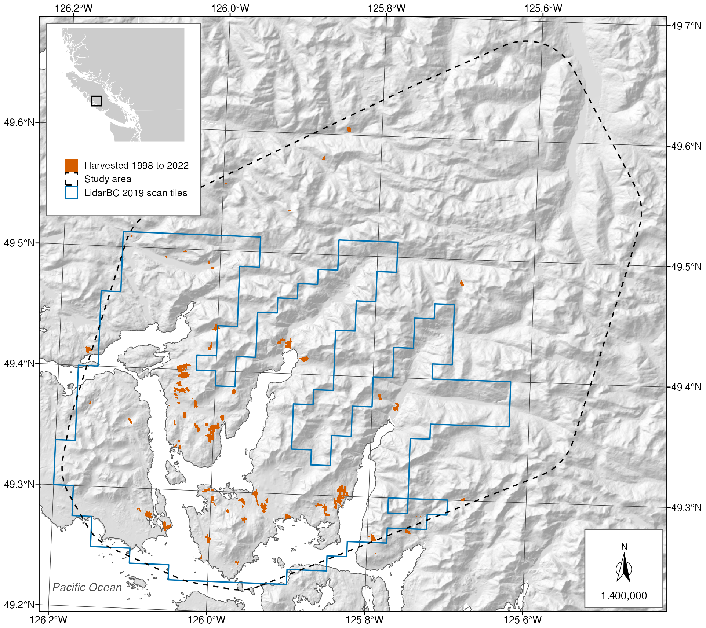
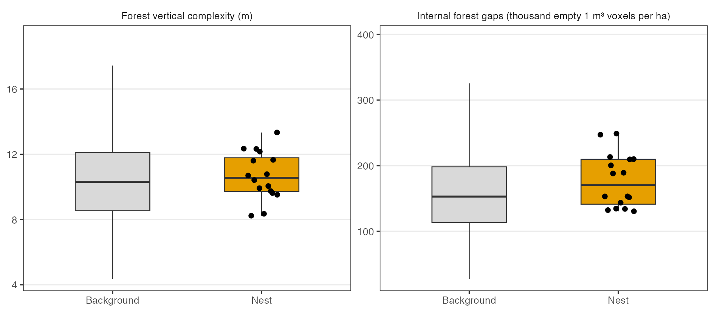

# Mapping Marbled Murrelet habitat in the Clayoquot Sound using ALS LiDAR data

## Abstract

Provincial airborne laser scans flown in 2019 measured old-growth forest structure in Clayoquot Sound, British Columbia. A nesting-habitat model for the threatened Marbled Murrelet, built from such scans and nests located in Desolation Sound, lost accuracy when transferred to Clayoquot Sound. Models fitted within one region had predicted nesting habitat better than pooled or transferred models, so a local model was expected to do better. This study rebuilt that model from 2019 scans and nests of birds radio-tracked from 2000 to 2002 (16 nest and 3,827 background cells in tall forest unharvested since 1998). Maximum entropy modeling of forest vertical complexity and internal forest gaps in 1 ha cells was scored by five-fold spatial cross-validation in 10 km blocks. Neither measure separated nest cells from background cells (forest vertical complexity, *P* = 0.54; internal forest gaps, *P* = 0.10). Nest cells had more internal forest gaps than background cells, though not significantly. The model classed 62.5 percent of held-out nest cells and 40.8 percent of background cells correctly, an average accuracy of 51.7 percent, which could not be distinguished from chance. The local model’s ranking of nest cells could not be shown to differ from that of the model transferred from Desolation Sound. With so few located nests, a local model gave no reason to replace the transferred model in mapping nesting habitat in Clayoquot Sound.

## Figures

**Figure 1.** Clayoquot Sound on the west coast of Vancouver Island, British Columbia. The dashed line bounded the study area, drawn 5 km around the radio-tracked nests. The blue line bounded the 322 LidarBC scan tiles flown in 2019, each about 2.5 km², and orange marked forest harvested from 1998 to 2022. Shading showed relief from the 30 m Medium Resolution Digital Elevation Model of Natural Resources Canada. Nest locations were not shown. The inset placed the study area on Vancouver Island. The main map was drawn at a scale of 1:400,000. Map lines delineate study areas and do not necessarily depict accepted national boundaries.

**Figure 2.** Forest vertical complexity and internal forest gaps at 16 nest cells (points) and 3,827 background cells in available forest, Clayoquot Sound. Boxes spanned the middle half of the values, the bar marked the median, and whiskers reached the furthest value within 1.5 box lengths. Values of background cells beyond the whiskers were not drawn.

## Tables

**Table 1.** Laser-scan measures entered in the model, with the direction of their relation to nest sites expected from prior work.

| Measure | Expected direction | Reasoning | Source |
|:---|:---|:---|:---|
| Forest vertical complexity | Positive | Taller forest with more variable structure was expected to offer more nest platforms and overhead cover. In Desolation Sound, predicted suitability rose with forest vertical complexity, and earlier ground studies had linked murrelets to vertically complex forest. Ground plots at Clayoquot Sound nests found shorter and less varied canopy than at random sites, so the direction was contested there. | (Burger and Bahn, 2004; Cosgrove et al., 2024; Silvergieter and Lank, 2011a, 2011b) |
| Internal forest gaps | Negative | In Desolation Sound, predicted suitability fell as internal forest gaps increased, although gaps had been expected to give flight access to nests. On the south coast, an air photo model placed nests where small gaps were sporadic but large gaps occurred. Small gaps had nonetheless been reported beside nest trees and at all 7 nest patches studied on Haida Gwaii. In Washington and on southwest Vancouver Island, nest sites were more open than nearby forest. | (Burger et al., 2009; Cosgrove et al., 2024; Waterhouse et al., 2008; Waterhouse et al., 2007; Wilk et al., 2016) |

**Table 2.** Nests and 1 ha cells at each step from the nest file to the modeled sample. Available forest was at least 20 m tall and unharvested from 1998 to 2022. It also passed the two scan checks, returns in at least 90% of 1 m columns and at least 10 points per m². A cell could fail more than one screen.

| Step                                                | Count |
|:----------------------------------------------------|:------|
| Nests in file                                       | 36    |
| Nest cells scanned                                  | 20    |
| Nest cells under 20 m tall                          | 0     |
| Nest cells with returns in under 90% of 1 m columns | 4     |
| Nest cells under 10 points per m²                   | 4     |
| Nest cells harvested from 1998 to 2022              | 0     |
| Nest cells in available forest                      | 16    |
| Background cells scanned                            | 7,869 |
| Background cells in available forest                | 3,827 |

**Table 3.** Steps from the nest file and scans to the modeled sample, with the data, dates, operation and output of each.

| Step | Data | Dates | Operation | Output |
|----|----|----|----|----|
| Nests | Movebank nest file (Cooke et al., 2022) | 2000 to 2002 | Nests located by radio telemetry, position error about 50 m | 36 nests |
| Scan tiles | LidarBC tile index | 2019 | Tiles within 150 m of a nest, and 40 drawn at random | 69 tiles |
| Point clouds | LidarBC compressed LAS files | 2019 | Contractor’s noise and withheld points dropped, thinned to at most 12 points per m² | Thinned tiles |
| Heights | Thinned points | 2019 | Normalized to a triangulated ground surface, 0 to 100 m kept | Heights above ground |
| Measures | Heights above ground | 2019 | Five measures in 1 ha cells | Grid of 1 ha cells |
| Harvest | Canada Forest Harvest (Hermosilla et al., 2016) | 1998 to 2022 | Stand-replacing harvest on a 30 m grid | Harvested cells |
| Available forest | Measures and harvest | 2019 | Height, harvest and scan screens | 16 nest and 3,827 background cells |
| Separability | Available forest | 2019 | *M* and Wilcoxon rank-sum test for each measure | <a href="#tbl-separability" class="quarto-xref">Table 4</a> |
| Model | Available forest | 2019 | MaxEnt on two measures, five folds of 10 km hexagonal blocks, repeated over 20 other assignments | Held-out predictions |
| Noise test | Thinned points | 2019 | Statistical outlier removal, refit on the same cells and folds | Paired AUC comparison |
| Larger cells | Thinned points | 2019 | Measures, screens, separability tests and model repeated in 4 and 9 ha cells | Separability and held-out predictions at 4 and 9 ha |
| Refits | Measures and harvest | 2019 | Sample redrawn without the scan checks, with nest-tile background, or with a 30 m minimum height, and the model refitted | Held-out predictions for each refit |

**Table 4.** Laser-scan measures at nest and background cells in available forest, as mean ± standard deviation (95% confidence interval). M was the separability index and W the Wilcoxon rank-sum statistic of the two groups. The Spearman correlation ρ with forest height, the skewness and the Shapiro-Wilk statistic were computed over all cells. The first two measures entered the model and the last three defined available forest. Intervals for columns with returns were truncated at 100%. \* P ≤ 0.05, \*\* P ≤ 0.01, \*\*\* P ≤ 0.001, \*\*\*\* P ≤ 0.0001.

| Measure | Nest | Background | M | W | ρ | Skewness | Shapiro-Wilk |
|:---|:---|:---|:---|:---|:---|:---|:---|
| Forest vertical complexity (m) | 10.67 ± 1.47 (9.89–11.46) | 10.37 ± 2.43 (10.29–10.45) | 0.08 | 33,355 | 0.96 | 0.14 | 0.994\*\*\*\* |
| Internal forest gaps (thousand voxels per ha) | 177.52 ± 40.90 (155.73–199.31) | 157.46 ± 56.84 (155.66–159.26) | 0.21 | 37,889 | 0.86 | 0.35 | 0.984\*\*\*\* |
| Forest height (m) | 34.74 ± 5.76 (31.66–37.81) | 33.54 ± 7.81 (33.29–33.78) | 0.09 | 33,762 | 1.00 | 0.16 | 0.975\*\*\*\* |
| Columns with returns (%) | 99.23 ± 1.60 (98.37–100.00) | 99.46 ± 1.31 (99.41–99.50) | 0.08 | 24,994 | -0.36 | -3.84 | 0.491\*\*\*\* |
| Point density (points per m²) | 11.80 ± 0.41 (11.58–12.02) | 11.78 ± 0.41 (11.76–11.79) | 0.03 | 30,220 | -0.03 | -2.03 | 0.683\*\*\*\* |

**Table 5.** Performance of the Clayoquot Sound model on held-out cells pooled over five spatial folds. The Desolation Sound model of Cosgrove et al. (2024) was shown beside it, in its own area and transferred to Clayoquot Sound. Intervals were 95% confidence intervals, from 1,000 bootstrap resamples for the Boyce index, and the row of fold draws gave the range. AUC was the area under the receiver operating characteristic curve, RMSE root mean square error and MAE mean absolute error. \* P ≤ 0.05, \*\* P ≤ 0.01, \*\*\* P ≤ 0.001, \*\*\*\* P ≤ 0.0001.

| Measure | Clayoquot Sound, local | Desolation Sound, own area | Desolation Sound, transferred |
|:---|:---|:---|:---|
| AUC | 0.53 (0.39 to 0.67) | 0.77 | 0.63 |
| AUC on training cells, mean of five folds | 0.64 (0.60 to 0.69) |  |  |
| AUC over 20 other fold draws, mean (range) | 0.51 (0.44 to 0.56) |  |  |
| Boyce index | 0.10 (-0.59 to 0.70) | 0.99 | 0.67 |
| Overall accuracy | 0.41 (0.39 to 0.43) |  |  |
| Kappa | 0.00 (-0.03 to 0.03) |  |  |
| Commission error, nest | 0.996 |  |  |
| Omission error, nest | 0.38 |  |  |
| Commission error, background | 0.004 |  |  |
| Omission error, background | 0.59 |  |  |
| R² | 0.00003 |  |  |
| RMSE | 0.61 |  |  |
| RMSE ratio | 1.01 |  |  |
| Relative RMSE | 145.98 |  |  |
| MAE | 0.60 |  |  |
| Brier score | 0.37 |  |  |
| Theil’s U bias | 0.96 |  |  |
| Moran’s I of residuals | 0.12\*\*\*\* |  |  |
| Durbin-Watson | 2.01 |  |  |
